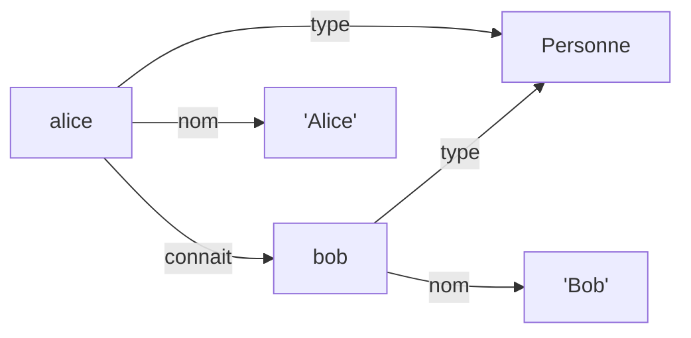

# Étape 1 — Les fondations du Web Sémantique (RDF & Triplets)

## Objectif

Comprendre la brique de base de toute la Représentation des Connaissances : **le triplet**.
À la fin de cette étape, tu sais lire et écrire à la main un graphe RDF minimal au format Turtle (`.ttl`).

---

## Concepts clés (expliqués simplement)

### 1. Le triplet : Sujet – Prédicat – Objet

Toute information en RDF s'exprime comme une mini-phrase de 3 éléments :

```
Sujet      Prédicat      Objet
Alice      connaît       Bob
```

- **Sujet** : ce dont on parle (Alice).
- **Prédicat** : la relation / propriété (connaît).
- **Objet** : la valeur ou la cible de la relation (Bob).

Un ensemble de triplets forme un **graphe** : les sujets et objets sont des nœuds, les prédicats sont des flèches.



### 2. Les URI / IRI : des identifiants mondiaux

Un mot comme `"Alice"` est ambigu : il existe des milliers d'Alice. Pour lever l'ambiguïté, RDF identifie les choses par une **IRI** (une sorte d'URL servant d'identifiant unique), par exemple :

```
http://exemple.org/alice
```

- **URI/IRI** = un identifiant unique et global (l'IRI est la version internationalisée de l'URI, qui accepte les caractères non-ASCII).
- L'adresse n'a pas besoin de pointer vers une vraie page web ; elle sert juste de **nom unique**.
- Grâce à cela, deux bases de données différentes qui parlent de `http://exemple.org/alice` parlent **de la même Alice**.

Dans le fichier, une IRI s'écrit entre chevrons : `<http://exemple.org/alice>`.

### 3. Littéral vs IRI

- Un **littéral** est une valeur brute (texte, nombre, date). Il s'écrit entre guillemets : `"Alice"`.
- Une **IRI** est un identifiant d'objet : `<http://exemple.org/bob>`.

Règle simple : si l'objet est *une autre chose* à laquelle on pourrait se relier → IRI. Si c'est *une donnée plate* → littéral.

### 4. Pourquoi le texte brut ou le JSON ne suffisent pas ?

Imaginons deux fichiers JSON venant de deux entreprises :

```json
{ "name": "Alice", "knows": "Bob" }
```
```json
{ "fullName": "Alice", "friend_of": "Bob" }
```

Problèmes :
- **Les clés sont locales et arbitraires** : `name`, `fullName`, `knows`, `friend_of`... Aucune machine ne sait que ce sont les mêmes notions.
- **Pas d'identité globale** : le `"Bob"` de l'un est-il le `"Bob"` de l'autre ? Impossible à savoir.
- **Pas de lien entre jeux de données** : fusionner deux JSON, c'est réécrire du code à la main à chaque fois.

RDF résout exactement ces trois points : prédicats identifiés par des IRI partagées, sujets/objets identifiés globalement, et fusion de graphes triviale (il suffit de mettre tous les triplets dans le même sac).

---

## Le fichier de données

Ouvre [personnes.ttl](personnes.ttl). Il contient nos premiers triplets en IRIs complètes (sans raccourci) pour bien voir la forme brute. On y modélise :

- Alice et Bob sont des `Personne`.
- Alice connaît Bob.
- Alice et Bob ont un `nom` (littéral).

## Manipulations (notebook)

Pour pratiquer pas à pas, ouvre le notebook [manipulations.ipynb](manipulations.ipynb) : tu y construis le graphe **triplet par triplet** en Python, tu l'exportes en Turtle et tu le parcours. Lance-le avec Jupyter après `pip install -r requirements.txt`.

---

## Exercice guidé

> **Énoncé :** Ajoute dans `personnes.ttl` les informations suivantes, en respectant la forme `<Sujet> <Prédicat> <Objet> .`
>
> 1. Une nouvelle personne **Carol** (IRI : `http://exemple.org/carol`), qui est une `Personne`.
> 2. Le fait que **Bob connaît Carol**.
> 3. Le **nom** de Carol, en littéral.

Essaie d'abord par toi-même, puis compare avec la solution ci-dessous.

<details>
<summary>Afficher la solution</summary>

```turtle
# Carol est une Personne
<http://exemple.org/carol> <http://www.w3.org/1999/02/22-rdf-syntax-ns#type> <http://exemple.org/Personne> .

# Bob connait Carol
<http://exemple.org/bob> <http://exemple.org/connait> <http://exemple.org/carol> .

# Le nom de Carol
<http://exemple.org/carol> <http://exemple.org/nom> "Carol" .
```

Remarque : on réutilise exactement les mêmes prédicats (`...#type`, `connait`, `nom`) que pour Alice et Bob. C'est tout l'intérêt : un vocabulaire partagé rend les données cohérentes et interrogeables.

</details>

---

## Points à retenir

- RDF = des **triplets** Sujet–Prédicat–Objet.
- Les choses sont nommées par des **IRI** (identité globale), les valeurs plates par des **littéraux**.
- Contrairement au JSON, RDF est conçu pour **lier des données entre sources différentes**.

➡️ Étape suivante : on arrête d'écrire ces longues IRIs à la main grâce aux **préfixes**, et on réutilise des vocabulaires standards (FOAF, Schema.org).
