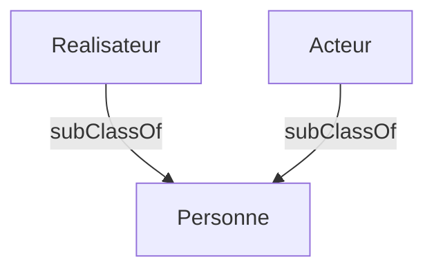

# Étape 5 — Introduction aux ontologies avec RDFS (schéma)

## Objectif

Arrêter de seulement *décrire des individus* et commencer à **décrire la structure** : qu'est-ce qu'une « Personne », un « Film » ? Quelles relations sont permises ? C'est le rôle de **RDFS** (RDF Schema), la première couche d'ontologie.

---

## Concepts clés (expliqués simplement)

### 1. Donnée (instance) vs schéma (classe)

C'est LA distinction fondamentale :

| Niveau | Question | Exemple |
|---|---|---|
| **Schéma** | « Quels *types* de choses existent ? » | La classe `Film`, la classe `Réalisateur` |
| **Donnée** | « Quelles choses concrètes existent ? » | `inception` (un Film), `nolan` (un Réalisateur) |

Le schéma, c'est le **moule** ; les instances, c'est ce qu'on **coule** dedans. Un fichier d'ontologie contient souvent les deux.

### 2. Les classes (`rdfs:Class`)

Une classe est une **catégorie**. On la déclare ainsi :

```turtle
ex:Film a rdfs:Class .
```

Et on dit qu'un individu appartient à une classe avec `a` (rappel : `a` = `rdf:type`) :

```turtle
ex:inception a ex:Film .
```

### 3. Les sous-classes (`rdfs:subClassOf`)

`rdfs:subClassOf` exprime « est une sorte de » :

```turtle
ex:Realisateur rdfs:subClassOf ex:Personne .
ex:Acteur      rdfs:subClassOf ex:Personne .
```

→ « Tout Réalisateur est une Personne », « tout Acteur est une Personne ». Cette information sera **exploitée par le raisonneur** à l'étape 6 : interroger « Personne » ramènera aussi les Acteurs et Réalisateurs.



### 4. Les propriétés et leur `domain` / `range`

Une propriété (relation) peut préciser :
- son **`rdfs:domain`** : le type attendu du **sujet** ;
- son **`rdfs:range`** : le type attendu de l'**objet**.

```turtle
ex:aRealise rdfs:domain ex:Realisateur ;   # le sujet doit etre un Realisateur
            rdfs:range  ex:Film .            # l'objet doit etre un Film
```

Attention au piège mental : en RDFS, `domain`/`range` ne sont **pas des contraintes de validation** (ça ne « rejette » rien). Ce sont des **règles d'inférence** : si on écrit `ex:x ex:aRealise ex:y`, le raisonneur en **déduit** que `ex:x` est un Réalisateur et `ex:y` un Film (voir étape 6).

---

## Le fichier d'ontologie

[films.ttl](films.ttl) est organisé en 3 blocs commentés : les **classes**, les **propriétés** (avec domain/range), puis les **individus**.

Choix volontaire : les individus (`nolan`, `dicaprio`...) sont typés avec leur classe **la plus précise** (`Realisateur`, `Acteur`) et **pas** explicitement comme `Personne`. On verra à l'étape 6 que le raisonneur comble ce « trou » tout seul.

## Le notebook

[manipulations.ipynb](manipulations.ipynb) te fait explorer l'ontologie : lister les classes, les sous-classes, les propriétés et leur domain/range, puis interroger les individus. (On ne fait **pas encore** d'inférence ici : c'est l'étape 6.)

---

## Exercice guidé

> **Énoncé :** Enrichis `films.ttl` pour ajouter la notion de **Scénariste** :
>
> 1. Crée une classe `ex:Scenariste`, sous-classe de `ex:Personne`.
> 2. Crée une propriété `ex:aEcrit` (domain `Scenariste`, range `Film`).
> 3. Ajoute un individu `ex:goldman` (« William Goldman ») qui a écrit un film de ton choix.

<details>
<summary>Afficher la solution</summary>

```turtle
# Schema
ex:Scenariste a rdfs:Class ;
    rdfs:label "Scenariste" ;
    rdfs:subClassOf ex:Personne .

ex:aEcrit a rdf:Property ;
    rdfs:label "a ecrit" ;
    rdfs:domain ex:Scenariste ;
    rdfs:range ex:Film .

# Donnee
ex:goldman a ex:Scenariste ;
    ex:nom "William Goldman" ;
    ex:aEcrit ex:inception .   # (exemple ; peu importe le film choisi)
```

</details>

---

## Points à retenir

- **Schéma** (classes/propriétés) ≠ **données** (individus).
- `rdfs:Class` déclare une catégorie ; `a` range un individu dedans.
- `rdfs:subClassOf` = « est une sorte de ».
- `rdfs:domain` / `rdfs:range` typent le sujet/objet d'une propriété — ce sont des **règles d'inférence**, pas des validations.

➡️ Étape suivante : on **active le raisonneur** et on voit toutes les connaissances qu'il déduit automatiquement de ce schéma.
