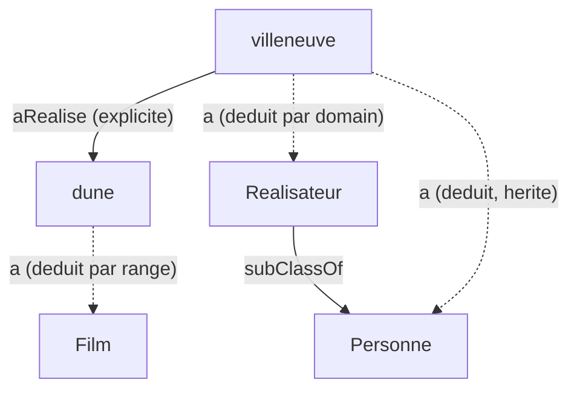

# Étape 6 — Raisonnement de base (inférence RDFS)

## Objectif

Découvrir le super-pouvoir des ontologies : **l'inférence**. Le raisonneur déduit automatiquement de nouveaux triplets à partir du schéma, sans qu'on les écrive. On le voit concrètement avec `rdflib` + `owlrl`.

---

## Concepts clés (expliqués simplement)

### 1. Inférence = déduire l'implicite

Une connaissance peut être **explicite** (écrite dans le fichier) ou **implicite** (logiquement déductible). Le raisonneur transforme l'implicite en explicite en ajoutant les triplets manquants au graphe. On appelle ça la **clôture (closure)** du graphe.

Exemple : on a écrit
```
nolan a Realisateur .
Realisateur subClassOf Personne .
```
On n'a **jamais** écrit `nolan a Personne`. Pourtant c'est vrai. Le raisonneur l'ajoute.

### 2. Les deux règles RDFS les plus utiles

**a) Héritage de classe (via `subClassOf`)**
> Si `X a ClasseA` et `ClasseA subClassOf ClasseB`, alors `X a ClasseB`.

→ Tout Réalisateur/Acteur devient aussi une Personne. La requête « les Personnes » fonctionne enfin directement.

**b) Typage par `domain` / `range`**
> Si `X propriété Y` et `propriété domain ClasseD`, alors `X a ClasseD`.
> Si `X propriété Y` et `propriété range ClasseR`, alors `Y a ClasseR`.

→ Comme `aRealise` a pour domain `Realisateur` et range `Film` :
- `villeneuve aRealise dune` permet de déduire `villeneuve a Realisateur` (donc aussi `a Personne`) et `dune a Film`,
- **alors qu'on n'a typé ni `villeneuve` ni `dune` dans le fichier !**


(Les flèches en pointillé sont déduites par le raisonneur.)

### 3. Comment on l'exécute (rdflib + owlrl)

```python
import owlrl
owlrl.RDFSClosure.RDFS_Semantics(graphe, axioms=False, daxioms=False, rdfs=True).closure()
```

Cette ligne **modifie le graphe sur place** : elle y ajoute tous les triplets inférés. Le nombre de triplets augmente, et les requêtes « voient » désormais les connaissances déduites.

---

## Le fichier de données

[films.ttl](films.ttl) reprend l'ontologie de l'étape 5 et ajoute un cas piégé : `villeneuve` et `dune` ne sont **pas** typés ; seul le triplet `villeneuve aRealise dune` est donné. Parfait pour observer l'inférence par domain/range.

## Le notebook

[manipulations.ipynb](manipulations.ipynb) fait la démonstration en **avant / après** : on exécute les mêmes requêtes une fois sans raisonneur (résultats pauvres), puis on lance l'inférence et on relance (résultats enrichis).

Lancement : `pip install -r requirements.txt` puis ouvre le notebook.

---

## Exercice guidé

> **Énoncé :** Avant d'exécuter le notebook, **prédis** ce que le raisonneur va déduire pour `villeneuve` et `dune`. Liste les nouveaux triplets `a` (rdf:type) attendus.

<details>
<summary>Afficher la solution</summary>

À partir de `villeneuve ex:aRealise ex:dune` :

1. `ex:aRealise` a pour `domain` `ex:Realisateur` → **`villeneuve a Realisateur`**.
2. `ex:Realisateur subClassOf ex:Personne` → **`villeneuve a Personne`**.
3. `ex:aRealise` a pour `range` `ex:Film` → **`dune a Film`**.

Donc après inférence, une requête « SELECT ?p WHERE { ?p a ex:Personne } » retournera aussi `villeneuve`, et « ?f a ex:Film » retournera aussi `dune`.

</details>

---

## Points à retenir

- L'inférence **matérialise les triplets implicites** (clôture du graphe).
- Règle `subClassOf` : un Acteur/Réalisateur est aussi une Personne.
- Règles `domain`/`range` : l'usage d'une propriété **type** automatiquement son sujet et son objet.
- En pratique : `owlrl.RDFSClosure...closure()` enrichit le graphe avant de requêter.

➡️ Étape suivante : RDFS atteint ses limites. On passe à **OWL** pour exprimer des propriétés symétriques, inverses, transitives.
