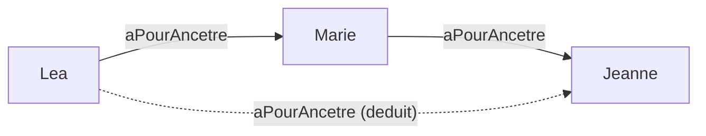

# Étape 7 — Transition vers OWL (Web Ontology Language)

## Objectif

Comprendre pourquoi RDFS ne suffit pas toujours, et découvrir ce qu'**OWL** ajoute : des propriétés au comportement logique riche (symétrique, inverse, transitive) et les restrictions de cardinalité. On observe l'inférence OWL avec `rdflib` + `owlrl`.

---

## Concepts clés (expliqués simplement)

### 1. Les limites de RDFS

RDFS sait dire « X est une sorte de Y » et « cette propriété relie tel type à tel type ». Mais il **ne sait pas** exprimer :
- qu'une relation marche dans les **deux sens** (si A connaît B, alors B connaît A) ;
- qu'une relation est l'**inverse** d'une autre (parent ↔ enfant) ;
- qu'une relation se **propage en chaîne** (ancêtre de l'ancêtre = ancêtre) ;
- des **contraintes de nombre** (« une personne a exactement 2 parents biologiques »).

OWL ajoute exactement ce vocabulaire.

### 2. Propriété symétrique (`owl:SymmetricProperty`)

```turtle
ex:connait a owl:SymmetricProperty .
ex:marie ex:connait ex:paul .
```
Le raisonneur déduit automatiquement : **`ex:paul ex:connait ex:marie`**. On n'écrit qu'un sens, on obtient les deux.

### 3. Propriétés inverses (`owl:inverseOf`)

```turtle
ex:aPourEnfant owl:inverseOf ex:aPourParent .
ex:marie ex:aPourEnfant ex:lea .
```
Déduction : **`ex:lea ex:aPourParent ex:marie`**. Une seule relation à maintenir, l'autre est gratuite.

### 4. Propriété transitive (`owl:TransitiveProperty`)

```turtle
ex:aPourAncetre a owl:TransitiveProperty .
ex:lea ex:aPourAncetre ex:marie .
ex:marie ex:aPourAncetre ex:jeanne .
```
Déduction : **`ex:lea ex:aPourAncetre ex:jeanne`** (l'ancêtre de mon ancêtre est mon ancêtre).



### 5. Les restrictions de cardinalité (aperçu)

OWL permet aussi de contraindre le **nombre** de valeurs d'une propriété, via `owl:Restriction`. Exemple : « une Personne a exactement 2 parents biologiques » :

```turtle
ex:Personne rdfs:subClassOf [
    a owl:Restriction ;
    owl:onProperty ex:aPourParentBiologique ;
    owl:cardinality 2
] .
```

On ne l'exécute pas dans le notebook (ça demande un raisonneur plus complet pour en tirer toutes les conséquences), mais c'est un outil clé d'OWL pour modéliser des règles métier précises.

---

## Le fichier d'ontologie

[famille.ttl](famille.ttl) déclare les trois types de propriétés et n'écrit **qu'un seul sens** de chaque relation. Tout le reste sera déduit.

## Le notebook

[manipulations.ipynb](manipulations.ipynb) reprend la logique **avant / après** : on interroge les relations sur le graphe brut (déductions absentes), puis on lance le raisonneur OWL et on les voit apparaître.

Lancement : `pip install -r requirements.txt` puis ouvre le notebook.

---

## Exercice guidé

> **Énoncé :** Ajoute à `famille.ttl` une propriété `ex:estMarieAvec` qui doit être **symétrique**, puis déclare que `ex:paul ex:estMarieAvec ex:marie`. Que va déduire le raisonneur ?

<details>
<summary>Afficher la solution</summary>

```turtle
ex:estMarieAvec a owl:SymmetricProperty ;
    rdfs:label "est marie avec" .

ex:paul ex:estMarieAvec ex:marie .
```

Le raisonneur déduira **`ex:marie ex:estMarieAvec ex:paul`** (symétrie). Une requête « avec qui Marie est-elle mariée ? » renverra Paul, alors qu'on ne l'a écrit que dans l'autre sens.

</details>

---

## Points à retenir

- OWL comble les limites de RDFS pour décrire le **comportement logique** des relations.
- `owl:SymmetricProperty` (les deux sens), `owl:inverseOf` (la relation miroir), `owl:TransitiveProperty` (la propagation en chaîne).
- `owl:Restriction` + `owl:cardinality` permettent des contraintes de nombre.
- En pratique : `owlrl.DeductiveClosure(owlrl.OWLRL_Semantics).expand(graphe)` matérialise toutes ces déductions.

Bravo, tu as parcouru les fondations de la Représentation des Connaissances : des triplets bruts jusqu'au raisonnement OWL.
