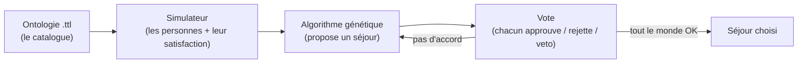

# Cours débutant — Vote de consensus (pour partir de zéro)

> Ce document est un **petit cours pas-à-pas**. Aucune connaissance préalable n'est supposée.
> Objectif : comprendre **à quoi sert le projet**, **à quoi sert chaque script**, et **comment le lancer**.
> Pour la version « concepts avancés », voir le dossier [docs/](docs/00_INDEX.md).

---

## 1. C'est quoi ce projet, en une phrase ?

**Plusieurs personnes doivent choisir UN séjour de vacances commun, et l'ordinateur les aide à se mettre d'accord.**

Imaginez 8 amis qui veulent partir ensemble. Chacun a ses goûts (plage ou montagne, petit ou gros budget, telle semaine…). Trouver un séjour qui convienne à tout le monde est difficile : c'est un **problème de consensus**. Ce projet le résout automatiquement.

### L'analogie

| Dans la vraie vie | Dans le projet |
|---|---|
| Le catalogue d'une agence de voyage | l'**ontologie** (un fichier `.ttl`) |
| Les goûts de chaque ami | une **`Personne`** (préférences + budget) |
| Un assistant qui propose des séjours | l'**algorithme génétique (GA)** |
| Le tour de table où chacun dit oui/non | le **protocole de vote** |
| « Moi je bloque, hors de question ! » | le **veto** (mais payant, donc limité) |
| « Bon allez, je cède un peu… » | le **relâchement** (à chaque tour, on devient plus souple) |

Le résultat : un séjour `(destination, activité, semaine)` qui met (presque) tout le monde d'accord.

---

## 2. Le déroulé, vu de loin



1. On lit le **catalogue** dans l'ontologie.
2. Le simulateur crée des **personnes** avec leurs goûts et calcule leur **satisfaction** pour un séjour.
3. Le **GA** propose le meilleur séjour qu'il trouve.
4. On **vote**. Pas d'accord ? Le GA réessaie (en évitant ce qui a été rejeté), et les exigences se relâchent.
5. Dès que c'est bon, on a notre **consensus**.

---

## 3. Installation (à faire une seule fois)

Il faut **Python 3.10+**. Depuis la racine du dépôt :

```bash
pip install -r requirements.txt
```

Cela installe `rdflib` (lire les ontologies), `numpy` (calculs), `matplotlib` + `networkx` (graphiques), `streamlit` (l'interface), etc.

> Astuce Windows / PowerShell : les commandes `python ...` ci-dessous fonctionnent telles quelles. Vous pouvez aussi vous placer dans le dossier avec `cd 09_vote_consensus_ga` puis lancer `python run.py`.

---

## 4. Comment lancer ? (les 5 points d'entrée)

Voici **tout ce qui se lance**, du plus simple au plus visuel.

### A. La simulation automatique (le plus simple pour commencer)

```bash
python 09_vote_consensus_ga/run.py
```

Affiche dans le terminal : les votants générés, le meilleur séjour, puis le déroulé du vote round par round jusqu'au consensus. **Commencez par ça.**

### B. L'interface graphique (pour jouer soi-même)

```bash
streamlit run 09_vote_consensus_ga/app_negociation.py
```

Ouvre une page web. À gauche vous **votez** (et changez de personne avec les flèches `◀ ▶`), à droite vous voyez l'**arbre de négociation** et la **courbe d'entropie**. Dans la barre latérale : choix de l'**ontologie**, nombre d'humains/NPC, règles du vote.

### C. Le notebook pédagogique (pour apprendre pas à pas)

Ouvrez [vote_consensus.ipynb](vote_consensus.ipynb) dans Jupyter ou VS Code, et exécutez les cellules une par une. Tout est expliqué et commenté.

### D. Le scénario à plusieurs camps (génère des images)

```bash
python 09_vote_consensus_ga/scenario_branches.py
```

Met en scène 3 camps qui ne sont pas d'accord, puis **sauvegarde** `entropie.png` et `arbre_negociation.png`.

### E. Le visualiseur d'ontologie (pour voir un fichier .ttl en image)

```bash
python 09_vote_consensus_ga/visualiseur_ontologie.py 09_vote_consensus_ga/ontologie_vacances2.ttl
```

Dessine le schéma de n'importe quelle ontologie (classes, sous-classes, propriétés, instances).

---

## 5. À quoi sert chaque script ? (et ses fonctions clés)

Voici le rôle de chaque fichier `.py`, et **à quoi sert chaque fonction importante**. Lisez la colonne « À quoi ça sert » comme une traduction en français simple.

### `simulateur.py` — *le décor et les gens*

> **À quoi sert ce script ?** Lire l'ontologie pour construire le catalogue, créer les personnes, et calculer leur satisfaction. C'est la « base de données + psychologie » du projet. Aucune logique de vote ici.

| Fonction | À quoi ça sert |
|---|---|
| `charger_catalogue()` | Lit l'ontologie **simple** et renvoie le catalogue (destinations + attributs). |
| `charger_catalogue_v2()` | Lit l'ontologie **réaliste** (zone / milieu / sport). Même format de sortie. |
| `lister_candidats(catalogue)` | Construit **toutes** les options possibles `(destination, activité, semaine)`. |
| `est_candidat_valide(...)` | Dit si une option est autorisée (ex. pas de ski en été). |
| `Personne` (dataclass) | Une personne = ses goûts, son budget, ses poids et ses crédits de veto. |
| `generer_personnes(n, ...)` | Crée `n` personnes aléatoires mais cohérentes. |
| `satisfaction(personne, attrs)` | **Cœur du projet** : note de 0 à 1 disant si un séjour plaît à une personne. |
| `seuil_acceptation(personne)` | À partir de quelle note la personne dit « oui ». |
| `creer_npc(nom, profil)` | Crée un votant automatique (NPC) à partir d'un profil prédéfini. |

### `consensus_ga.py` — *l'assistant qui cherche + le tour de table*

> **À quoi sert ce script ?** L'algorithme génétique qui explore les options, ET le protocole de vote complet (votes, veto payant, relâchement, entropie). C'est le **moteur**.

| Fonction | À quoi ça sert |
|---|---|
| `rechercher_consensus(catalogue, personnes, ...)` | **La fonction principale** : déroule toute la négociation et renvoie le résultat. |
| `meilleur_candidat_ga(...)` | Optimise juste la satisfaction, **sans** vote (utile pour comparer). |
| `fitness(candidat, ...)` | Note un séjour pour le groupe (bien-être moins pénalité de veto). |
| `croisement(...)`, `mutation(...)` | Les opérateurs génétiques : combinent et modifient les options. |
| `evoluer(...)` | Fait « évoluer » une population d'options sur plusieurs générations. |
| `entropie_votes(...)` | Mesure le **désaccord** (0 = unanime, 1 = groupe coupé en deux). |
| `entropie_exploration(...)` | Mesure si le GA explore large ou s'est concentré. |

### `strategies.py` — *les règles du jeu, interchangeables*

> **À quoi sert ce script ?** Des « briques » qu'on peut brancher dans `rechercher_consensus` pour changer la philosophie : comment agréger le bonheur du groupe, et quand déclarer l'accord.

| Fonction | À quoi ça sert |
|---|---|
| `bien_etre_moyenne / min / mixte / nash / leximin` | Différentes façons de résumer le bonheur du groupe en un seul chiffre. |
| `critere_unanimite() / supermajorite() / majorite() / plancher() / entropie()` | Différentes conditions pour dire « on est d'accord ». |
| `meilleur_exhaustif(...)` | Teste **toutes** les options pour trouver le vrai optimum (vérité-terrain). |

### `negociation_manuelle.py` — *le moteur quand c'est VOUS qui votez*

> **À quoi sert ce script ?** La logique de négociation où un humain vote round par round (utilisée par l'interface Streamlit). Gère aussi les NPC et les mécanismes pour forcer la décision.

| Fonction | À quoi ça sert |
|---|---|
| `demarrer(catalogue, noms, ...)` | Lance une négociation et propose le 1er séjour. |
| `enregistrer_vote(etat, nom, valeur)` | Enregistre le vote d'une personne. |
| `tous_ont_vote(etat)` | Dit si tout le monde a voté ce round. |
| `valider_round(etat)` | Clôt le round, regarde s'il y a consensus, sinon propose une nouvelle option. |
| `jouer_automatiquement(etat)` | Déroule tout seul la négociation si tous les votants sont des NPC. |

### `visualisation.py` — *les graphiques de la négociation*

> **À quoi sert ce script ?** Transformer l'historique d'une négociation en images.

| Fonction | À quoi ça sert |
|---|---|
| `tracer_entropie(historique)` | Dessine la courbe d'entropie (désaccord + exploration) round par round. |
| `tracer_arbre_negociation(historique)` | Dessine l'arbre des options explorées (vetos en rouge, consensus en vert). |

### `visualiseur_ontologie.py` — *voir une ontologie en image*

> **À quoi sert ce script ?** Outil **autonome** : il dessine le schéma de n'importe quel fichier `.ttl` (classes, hiérarchies, propriétés, instances). Se lance en ligne de commande (voir §4-E).

### `run.py` et `scenario_branches.py` — *des scripts « clé en main »*

> **À quoi servent-ils ?** Ce sont des **exemples exécutables**. `run.py` fait une démo complète dans le terminal ; `scenario_branches.py` met en scène 3 camps et sauvegarde les images. On les lance directement (voir §4-A et §4-D).

### `app_negociation.py` — *l'interface web (Streamlit)*

> **À quoi sert ce script ?** Construit la page web de vote. On ne le lance **pas** avec `python` mais avec `streamlit run` (voir §4-B).

---

## 6. Les fichiers de données (`.ttl`)

Un fichier `.ttl` (Turtle) est une façon d'écrire une **ontologie** : des classes, des objets et leurs propriétés. C'est juste du texte lisible.

| Fichier | Contenu |
|---|---|
| `ontologie_vacances.ttl` | Catalogue simple : type, localisation, coût, semaines, activités. |
| `ontologie_vacances2.ttl` | Catalogue réaliste : zone (avec hiérarchie), milieu (ville/nature), sports. |
| `ontologie_hebergement.ttl` | Exemple de hiérarchie d'hébergements (pour s'exercer au visualiseur). |
| `ontologie_activites.ttl` | Exemple de hiérarchie d'activités. |

---

## 7. Mini-glossaire (le jargon traduit)

| Mot | Traduction simple |
|---|---|
| **Ontologie** | Un catalogue structuré : on décrit les choses et leurs liens. |
| **RDF / Turtle (.ttl)** | Le langage texte pour écrire une ontologie. |
| **SPARQL** | Le « langage de questions » pour interroger une ontologie. |
| **Candidat** | Une option de séjour : `(destination, activité, semaine)`. |
| **Satisfaction** | Note de 0 à 1 : à quel point un séjour plaît à une personne. |
| **Algorithme génétique (GA)** | Une méthode qui « fait évoluer » des solutions pour trouver une bonne option. |
| **Fitness** | La note d'une option **pour le groupe** (le GA cherche à la maximiser). |
| **Bien-être** | La façon de résumer le bonheur du groupe (moyenne, minimum…). |
| **Consensus** | Le moment où le groupe est d'accord (selon le critère choisi). |
| **Veto** | Un blocage fort par une personne. Ici **payant** : limité, donc pas d'abus. |
| **Relâchement** | À chaque round sans accord, on devient un peu plus souple. |
| **Entropie** | Mesure du désordre/désaccord (0 = tout le monde d'accord). |
| **NPC** | « Non-Player Character » : un votant **automatique** aux goûts prédéfinis. |

---

## 8. « Je veux faire X » (recettes rapides)

**Je veux juste voir une démo →**
```bash
python 09_vote_consensus_ga/run.py
```

**Je veux voter moi-même →**
```bash
streamlit run 09_vote_consensus_ga/app_negociation.py
```

**Je veux changer le nombre de personnes →** modifiez `NB_PERSONNES` en haut de [run.py](run.py).

**Je veux essayer l'ontologie réaliste en code →**
```python
from consensus_ga import rechercher_consensus
from simulateur import charger_catalogue_v2, creer_npc, PROFILS_NPC_V2

catalogue = charger_catalogue_v2()
npcs = [creer_npc(n, p, profils=PROFILS_NPC_V2)
        for n, p in zip(["Nina", "Otto", "Rita"], list(PROFILS_NPC_V2)[:3])]
resultat = rechercher_consensus(catalogue, npcs)
print(resultat.attrs)
```

**Je veux changer la règle d'accord (ex. majorité au lieu d'unanimité) →**
```python
from strategies import critere_majorite
rechercher_consensus(catalogue, personnes, critere_consensus=critere_majorite())
```

---

## 9. Problèmes courants

| Symptôme | Cause probable | Solution |
|---|---|---|
| `ModuleNotFoundError: No module named 'rdflib'` | Dépendances non installées | `pip install -r requirements.txt` |
| `streamlit : command not found` | Streamlit non installé | `pip install streamlit` (ou la ligne ci-dessus) |
| `FileNotFoundError ... .ttl` | Lancé depuis le mauvais dossier | Lancez depuis la racine du dépôt, ou `cd 09_vote_consensus_ga`. |
| La fenêtre du graphique ne s'affiche pas | Pas d'écran / environnement headless | Utilisez l'option `--sortie image.png` du visualiseur. |

---

## 10. Et après ?

- Lisez le [README.md](README.md) du projet pour la vue d'ensemble complète.
- Plongez dans le notebook [vote_consensus.ipynb](vote_consensus.ipynb) pour manipuler.
- Pour les concepts avancés (architecture, protocole, stratégies) : [docs/00_INDEX.md](docs/00_INDEX.md).
