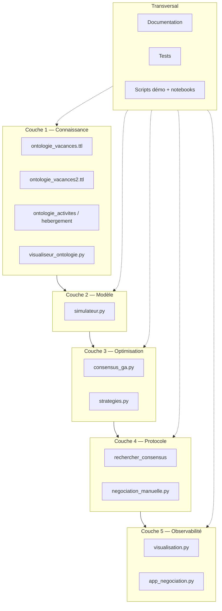

# Development Map — Projet Vote de Consensus

> Document de pilotage pour **mener le projet de bout en bout** : périmètre, livrables, phases, tests.
> Public : vous (chef de projet solo ou petit groupe), avant de coder ou de prioriser.
>
> **État au 2026-06** : prototype pédagogique fonctionnel (couches 1 à 5). Cette map indique ce qui est **fait**, ce qui **manque**, et comment **industrialiser** (tests, CI, évolutions).

---

## 1. Vision et objectifs

| | |
|---|---|
| **Problème** | N personnes doivent choisir **un** séjour commun alors que leurs préférences divergent. |
| **Solution** | Ontologie (catalogue structuré) + algorithme génétique (exploration) + protocole de vote (décision + veto payant). |
| **Public cible (v1)** | Apprentissage KR / data scripting — démo convaincante, notebooks, interface manuelle. |
| **Public cible (v2, optionnel)** | Produit « Consensus Engine » (voir [docs/PROMPT_PRODUIT.md](docs/PROMPT_PRODUIT.md)). |

**Critères de succès v1 (prototype actuel)**

- [x] Un séjour `(destination, activité, semaine)` est proposé et un consensus (ou compromis) est atteint.
- [x] Deux ontologies branchables sans modifier le moteur.
- [x] Stratégies interchangeables (bien-être, critère, vote, veto).
- [x] Visualisation (entropie + arbre) et interface Streamlit.
- [ ] Suite de tests unitaires automatisés + CI.
- [ ] Couverture documentée des cas limites (veto, date butoir, élimination).

---

## 2. Carte des éléments du projet

Le projet est découpé en **5 couches** + **transversal** (docs, tests, démos).



### Tableau des éléments (modules = unités de travail)

| ID | Élément | Fichiers | Responsabilité | Statut |
|---|---|---|---|---|
| E1 | **Ontologie simple** | `ontologie_vacances.ttl`, `ontologie_activites.ttl` | Catalogue type / localisation / activité / semaine | ✅ Fait |
| E2 | **Ontologie réaliste** | `ontologie_vacances2.ttl` | Zone hiérarchisée, milieu, sports, saison | ✅ Fait |
| E3 | **Loaders catalogue** | `simulateur.py` (`charger_catalogue`, `charger_catalogue_v2`) | SPARQL → dict Python + `ACTIVITES` | ✅ Fait |
| E4 | **Modèle Personne** | `simulateur.py` | Préférences, poids, marge, veto | ✅ Fait |
| E5 | **Satisfaction** | `simulateur.py` | Score générique multi-critères | ✅ Fait |
| E6 | **Espace candidats** | `simulateur.py` | `lister_candidats`, `est_candidat_valide` | ✅ Fait |
| E7 | **Algorithme génétique** | `consensus_ga.py` | Croisement, mutation, évolution, fitness | ✅ Fait |
| E8 | **Stratégies** | `strategies.py` | Bien-être, critères, exhaustif | ✅ Fait |
| E9 | **Protocole auto** | `consensus_ga.py` | Votes, veto (3 modes), relâchement, historique | ✅ Fait |
| E10 | **Négociation manuelle** | `negociation_manuelle.py` | Humains + NPC, forçage (dégressif, élimination) | ✅ Fait |
| E11 | **Visualisation** | `visualisation.py` | Entropie, arbre | ✅ Fait |
| E12 | **Interface Streamlit** | `app_negociation.py` | Vote manuel, choix ontologie | ✅ Fait |
| E13 | **Visualiseur ontologie** | `visualiseur_ontologie.py` | Graphe `.ttl` générique | ✅ Fait |
| E14 | **Démos & notebooks** | `run.py`, `scenario_branches.py`, `*.ipynb` | Parcours pédagogique | ✅ Fait |
| E15 | **Documentation** | `README`, `COURS_DEBUTANT`, `docs/` | Concepts, guide, glossaire | ✅ Fait |
| E16 | **Tests automatisés** | `tests/` | Unit + intégration | ✅ Fait (49 tests) |
| E17 | **CI / qualité** | `.github/workflows/tests.yml` | pytest sur push/PR | ✅ Fait |

---

## 3. Phases de développement (roadmap)

### Phase 0 — Cadrage (1–2 j)

| Livrable | Description | Statut |
|---|---|---|
| D0.1 | Problème et périmètre v1 | ✅ [01_PROBLEME_ET_VISION](docs/01_PROBLEME_ET_VISION.md) |
| D0.2 | Glossaire partagé | ✅ [09_GLOSSAIRE](docs/09_GLOSSAIRE.md) |
| D0.3 | Cette development map | ✅ Ce fichier |

**Definition of Done (DoD) phase 0** : un lecteur externe comprend le « quoi / pourquoi » en 15 min.

---

### Phase 1 — Fondations données (E1–E6)

| Livrable | Description | Statut |
|---|---|---|
| D1.1 | Ontologie vacances + activités liées | ✅ |
| D1.2 | Ontologie v2 (zone / milieu / sport) | ✅ |
| D1.3 | `charger_catalogue()` / `charger_catalogue_v2()` | ✅ |
| D1.4 | Candidat = triplet `(dest, act, semaine)` | ✅ |
| D1.5 | Filtre saison (été / hiver / toute l'année) | ✅ |

**DoD phase 1**

- [x] `lister_candidats` > 0 pour les deux ontologies.
- [x] Aucun candidat invalidé par `est_candidat_valide` après mutation GA.
- [ ] Tests unitaires E1–E6 (voir §5).

---

### Phase 2 — Moteur d'optimisation (E7–E8)

| Livrable | Description | Statut |
|---|---|---|
| D2.1 | Fitness = bien-être − pénalité veto | ✅ |
| D2.2 | GA : population, élitisme, tournoi, croisement, mutation | ✅ |
| D2.3 | 5 fonctions de bien-être + catalogue `BIENS_ETRE` | ✅ |
| D2.4 | Moteur exhaustif (référence) | ✅ |
| D2.5 | Notebook comparaison GA vs exhaustif | ✅ `comparaison_strategies.ipynb` |

**DoD phase 2**

- [x] `meilleur_candidat_ga` renvoie un candidat valide.
- [x] Sur petite graine fixe, GA proche de l'exhaustif (écart fitness < seuil documenté).
- [ ] Tests unitaires opérateurs GA et stratégies (§5).

---

### Phase 3 — Protocole de consensus (E9–E10)

| Livrable | Description | Statut |
|---|---|---|
| D3.1 | Boucle rounds : GA → vote → veto → critère → relâchement | ✅ |
| D3.2 | Modes vote : binaire, score | ✅ |
| D3.3 | Modes veto : simple, quadratique, coalition | ✅ |
| D3.4 | Historique round (contrat visualisation) | ✅ |
| D3.5 | Négociation manuelle + NPC + auto-run | ✅ |
| D3.6 | Forçage : critère dégressif, élimination, date butoir | ✅ |

**DoD phase 3**

- [x] `rechercher_consensus` termine en ≤ `max_rounds` avec un candidat.
- [x] Veto consomme des crédits ; candidat vetoté pénalisé au round suivant.
- [x] `scenario_branches.py` produit PNG sans erreur.
- [ ] Tests protocole (§5.3, §5.4).

---

### Phase 4 — Observabilité & UX (E11–E14)

| Livrable | Description | Statut |
|---|---|---|
| D4.1 | Courbe entropie (votes + exploration) | ✅ |
| D4.2 | Arbre de négociation (vetos rouges, consensus vert) | ✅ |
| D4.3 | App Streamlit (vote, flèches, sidebar config) | ✅ |
| D4.4 | Sélecteur d'ontologie dans l'app | ✅ |
| D4.5 | `run.py` démo terminal | ✅ |
| D4.6 | Notebook pédagogique complet | ✅ `vote_consensus.ipynb` |
| D4.7 | Cours débutant | ✅ `COURS_DEBUTANT.md` |

**DoD phase 4**

- [x] Streamlit démarre sans traceback.
- [x] Historique alimente les deux graphiques.
- [ ] Test smoke Streamlit (optionnel, §5.6).

---

### Phase 5 — Qualité & industrialisation (E16–E17) — **prochaine priorité**

| Livrable | Description | Statut |
|---|---|---|
| D5.1 | Dossier `tests/` + `pytest` dans `requirements.txt` | ✅ |
| D5.2 | Tests unitaires par module (§5) | ✅ (49 tests) |
| D5.3 | Tests d'intégration « bout en bout » (§6) | ⚠️ partiel (smoke via pytest) |
| D5.4 | Script `pytest` documenté dans README | ✅ |
| D5.5 | CI GitHub Actions | ✅ `.github/workflows/tests.yml` |
| D5.6 | (Optionnel) `ruff` ou `flake8` en pre-commit | ❌ |

**DoD phase 5**

- [ ] `pytest tests/ -q` vert en local.
- [ ] Couverture minimale : simulateur, strategies, consensus_ga (≥ 70 % lignes sur ces 3 fichiers).
- [ ] Aucune régression sur `run.py` et `scenario_branches.py` (smoke manual ou script).

---

### Phase 6 — Extensions (backlog, post-v1)

| Idée | Élément | Priorité |
|---|---|---|
| Plugin loader ontologie (config YAML) | E3 | Moyenne |
| Intégrer `ontologie_hebergement` dans le candidat | E1 | Basse |
| API REST (FastAPI) autour du moteur | Nouveau | Basse |
| Second domaine (budget municipal, etc.) | E1 | Moyenne |
| Produit blockchain | [PROMPT_PRODUIT](docs/PROMPT_PRODUIT.md) | Long terme |

---

## 4. Inventaire des livrables (vue consolidée)

| Type | Livrable | Fichier / artefact | Phase |
|---|---|---|---|
| **Données** | Ontologie simple | `ontologie_vacances.ttl` | 1 |
| **Données** | Ontologie réaliste | `ontologie_vacances2.ttl` | 1 |
| **Données** | Ontologies voisines | `ontologie_activites.ttl`, `ontologie_hebergement.ttl` | 1 |
| **Code** | Simulateur | `simulateur.py` | 1 |
| **Code** | GA + protocole | `consensus_ga.py` | 2–3 |
| **Code** | Stratégies | `strategies.py` | 2 |
| **Code** | Négociation manuelle | `negociation_manuelle.py` | 3 |
| **Code** | Visualisation | `visualisation.py` | 4 |
| **Code** | UI | `app_negociation.py` | 4 |
| **Code** | Visualiseur TTL | `visualiseur_ontologie.py` | 4 |
| **Démo** | Simulation CLI | `run.py` | 4 |
| **Démo** | Scénario branches | `scenario_branches.py` | 3 |
| **Démo** | Notebook tutoriel | `vote_consensus.ipynb` | 4 |
| **Démo** | Notebook comparaison | `comparaison_strategies.ipynb` | 2 |
| **Doc** | README projet | `README.md` | 0–4 |
| **Doc** | Cours débutant | `COURS_DEBUTANT.md` | 4 |
| **Doc** | Architecture & concepts | `docs/*.md` | 0–4 |
| **Doc** | Development map | `DEVELOPMENT_MAP.md` | 0 |
| **Image** | Aperçus ontologies | `apercu_*.png` | 4 |
| **Image** | Sorties négociation | `entropie.png`, `arbre_negociation.png` | 3 |
| **Tests** | Suite pytest | `tests/test_*.py` | 5 |
| **Ops** | CI | `.github/workflows/tests.yml` | 5 |

---

## 5. Plan des tests unitaires

> **Outil recommandé** : `pytest` (+ `pytest-cov` pour la couverture).
> **Convention** : un fichier `tests/test_<module>.py` par module métier.
> **Graine fixe** : toujours passer `graine=42` (ou `np.random.default_rng(42)`) pour des tests déterministes.

### 5.1 Installation tests

```bash
pip install pytest pytest-cov
# Ajouter dans requirements.txt (section dev ou commentée) :
# pytest>=8.0
# pytest-cov>=5.0
```

```bash
# Lancer tous les tests
pytest 09_vote_consensus_ga/tests/ -v

# Avec couverture sur les modules cœur
pytest 09_vote_consensus_ga/tests/ --cov=09_vote_consensus_ga/simulateur --cov=09_vote_consensus_ga/strategies --cov=09_vote_consensus_ga/consensus_ga
```

---

### 5.2 `tests/test_simulateur.py` — Couche modèle (E3–E6)

| Test | Fonction / objet | Assertion attendue |
|---|---|---|
| `test_charger_catalogue_non_vide` | `charger_catalogue()` | `len(catalogue) >= 10` |
| `test_charger_catalogue_v2_non_vide` | `charger_catalogue_v2()` | `len(catalogue) >= 8`, clés `zone`, `milieu` |
| `test_lister_candidats_v1` | `lister_candidats(cat1)` | `len > 0`, chaque tuple longueur 3 |
| `test_lister_candidats_v2` | `lister_candidats(cat2)` | idem + saison respectée (ski pas en sem 30) |
| `test_est_candidat_valide_ok` | candidat tiré de la liste | `True` |
| `test_est_candidat_valide_ko_dest` | dest inventée | `False` |
| `test_est_candidat_valide_ko_saison` | plongée + semaine hiver si règle | `False` |
| `test_activite_valide_pour_semaine_ete` | dict saison `"Ete"`, sem 30 | `True` |
| `test_activite_valide_pour_semaine_hiver` | dict saison `"Ete"`, sem 5 | `False` |
| `test_satisfaction_match_parfait` | Personne alignée sur attrs | `satisfaction ≈ 1.0` |
| `test_satisfaction_budget_depasse` | cout_total >> budget | score budget bas |
| `test_satisfaction_critere_absent` | poids sans `animation`, attrs sans | pas de KeyError, score calculé |
| `test_attributs_candidat_cles` | `attributs_candidat` | contient `nom`, `cout_total`, `semaine`, `activite` |
| `test_generer_personnes_taille` | `generer_personnes(5, ...)` | `len == 5`, noms uniques |
| `test_seuil_acceptation_marge` | marge haute vs basse | seuil plus bas si marge haute |
| `test_creer_npc_profil_inconnu` | mauvais profil | `ValueError` |
| `test_creer_npc_v2` | `PROFILS_NPC_V2` | Personne avec `zone_preferee` |

**Fixture recommandée** (`tests/conftest.py`) :

```python
import pytest
from simulateur import charger_catalogue, charger_catalogue_v2

@pytest.fixture
def catalogue_v1():
    return charger_catalogue()

@pytest.fixture
def catalogue_v2():
    return charger_catalogue_v2()
```

---

### 5.3 `tests/test_strategies.py` — Stratégies (E8)

| Test | Fonction | Assertion |
|---|---|---|
| `test_bien_etre_moyenne` | vecteur `[0.8, 0.6]` | `0.7` |
| `test_bien_etre_min` | idem | `0.6` |
| `test_bien_etre_mixte` | idem | `0.65` |
| `test_bien_etre_nash_positif` | pas de zero | `> 0` |
| `test_critere_unanimite_ok` | `[True, True]` | `True` |
| `test_critere_unanimite_ko` | `[True, False]` | `False` |
| `test_critere_supermajorite_75` | 3/4 True | `True` |
| `test_critere_majorite` | 2/3 True | `True` |
| `test_critere_plancher` | min sats < 0.4 | `False` |
| `test_meilleur_exhaustif_coherent` | cat + 2 personnes | candidat valide, `valeur` dans [0,1] |
| `test_exhaustif_vs_ga_proche` | même graine, petit catalogue | fitness exhaustif ≥ fitness GA − ε |

---

### 5.4 `tests/test_consensus_ga.py` — GA & protocole (E7, E9)

| Test | Fonction | Assertion |
|---|---|---|
| `test_entropie_votes_unanime` | 8/8 approuvent | `0.0` |
| `test_entropie_votes_divise` | 4/8 | `> 0` |
| `test_candidat_aleatoire_dans_liste` | `candidat_aleatoire` | membre de `candidats` |
| `test_croisement_produit_valide` | `croisement` + `_normaliser` | `est_candidat_valide` |
| `test_mutation_produit_valide` | `mutation` taux=1.0 | candidat valide |
| `test_fitness_baisse_avec_veto` | même candidat, vetos `{}` vs `{c: {0}}` | fitness veto < fitness sans |
| `test_meilleur_candidat_ga_retour` | `meilleur_candidat_ga` | `Resultat` avec attrs, satisfactions |
| `test_rechercher_consensus_termine` | 4 personnes, graine 42 | `nb_rounds <= max_rounds` |
| `test_rechercher_consensus_historique` | idem | `len(historique) == nb_rounds` |
| `test_veto_simple_consomme_credit` | mode simple, sat basse | crédits diminuent |
| `test_veto_coalition_seuil_k` | k=2, 1 seul payeur | pas de veto appliqué |
| `test_mode_score_remplit_scores` | `mode_vote="score"` | clé `scores` dans historique |

---

### 5.5 `tests/test_negociation_manuelle.py` — Mode humain (E10)

| Test | Fonction | Assertion |
|---|---|---|
| `test_demarrer_etat_initial` | `demarrer` | `leader` valide, NPC pré-votés |
| `test_enregistrer_vote` | vote humain | présent dans `votes_round` |
| `test_tous_ont_vote_false` | 1/3 voté | `False` |
| `test_valider_round_sans_consensus` | votes partiels rejetés | pas de crash |
| `test_valider_round_consensus` | votes tous approuvent + unanimité | `consensus_atteint` |
| `test_critere_degressif` | round 6 simulé | critère effectif = majorité |
| `test_elimination_reduit_candidats` | `elimination=True` | `len(candidats)` diminue |
| `test_jouer_automatiquement_npc_only` | 3 NPC, pas d'humain | termine, `consensus_atteint` ou max_rounds |

---

### 5.6 `tests/test_visualisation.py` — Graphiques (E11)

| Test | Fonction | Assertion |
|---|---|---|
| `test_tracer_entropie_retourne_figure` | historique 3 rounds | objet `Figure`, pas d'exception |
| `test_tracer_arbre_historique_vide` | `[]` | gère le cas ou lève erreur documentée |
| `test_tracer_arbre_avec_veto` | historique avec vetos | figure créée |

*(Utiliser backend matplotlib `Agg` en fixture pour éviter d'ouvrir une fenêtre.)*

---

### 5.7 `tests/test_ontologie_ttl.py` — Intégrité RDF (E1–E2)

| Test | Assertion |
|---|---|
| `test_parse_vacances_ttl` | `Graph().parse("ontologie_vacances.ttl")` sans exception |
| `test_parse_vacances2_ttl` | idem v2 |
| `test_vacances_a_des_destinations` | requête SPARQL `?d a v:Destination` ≥ 10 |
| `test_vacances2_zones_hierarchie` | `Mediterranee rdfs:subClassOf Europe` présent |

---

## 6. Tests d'intégration (non unitaires mais obligatoires phase 5)

| ID | Scénario | Commande / script | Critère succès |
|---|---|---|---|
| I1 | Démo terminal complète | `python run.py` | exit 0, ligne « CONSENSUS » ou compromis |
| I2 | Scénario branches | `python scenario_branches.py` | `entropie.png` + `arbre_negociation.png` créés |
| I3 | Deux ontologies, même moteur | script Python court | consensus v1 et v2 |
| I4 | Streamlit import | `python -c "import app_negociation"` | exit 0 |
| I5 | Notebook vote_consensus | `jupyter nbconvert --execute vote_consensus.ipynb` | exit 0 (optionnel CI) |
| I6 | Visualiseur PNG | `visualiseur_ontologie.py ... --sortie /tmp/t.png` | fichier existe |

---

## 7. Matrice de traçabilité (élément → tests)

| Élément | Tests unitaires | Tests intégration |
|---|---|---|
| E1 Ontologie simple | `test_ontologie_ttl` | I1, I3 |
| E2 Ontologie v2 | `test_ontologie_ttl`, `test_simulateur v2` | I3 |
| E3 Loaders | `test_charger_catalogue*` | I3 |
| E4–E5 Personne / satisfaction | `test_simulateur` | I1 |
| E6 Candidats | `test_lister_candidats`, `test_est_candidat_valide` | I1 |
| E7 GA | `test_consensus_ga` (croisement, mutation) | I1 |
| E8 Stratégies | `test_strategies` | I1, comparaison notebook |
| E9 Protocole auto | `test_consensus_ga` (consensus, veto) | I1, I2 |
| E10 Négociation manuelle | `test_negociation_manuelle` | I4 |
| E11 Visualisation | `test_visualisation` | I2 |
| E12 Streamlit | smoke import | I4 |
| E13 Visualiseur | — | I6 |

---

## 8. Planning indicatif (solo, à adapter)

| Semaine | Focus | Livrables |
|---|---|---|
| S1 | Phase 5 — setup tests | `tests/conftest.py`, `test_simulateur.py`, `test_strategies.py` |
| S2 | Phase 5 — suite | `test_consensus_ga.py`, `test_negociation_manuelle.py` |
| S3 | Phase 5 — CI + doc | pytest dans README, workflow GitHub, badge optional |
| S4 | Polish | corriger régressions, augmenter couverture, revue doc |
| S5+ | Phase 6 backlog | plugin ontologie, API, second domaine |

**Ordre de priorité si le temps manque**

1. `test_simulateur.py` (tout le reste en dépend).
2. `test_strategies.py` (rapide, pure functions).
3. `test_consensus_ga.py` (cœur métier).
4. Intégration I1 + I3.
5. Le reste.

---

## 9. Definition of Done — ticket / tâche

Avant de cocher une tâche dans cette map :

- [ ] Code fonctionne avec les deux ontologies (si touché simulateur / GA).
- [ ] Test(s) unitaire(s) ajoutés ou mis à jour.
- [ ] `pytest` vert localement.
- [ ] Doc mise à jour si comportement public change (README ou `docs/`).
- [ ] Pas de régression sur `run.py` (smoke manuel minimum).

---

## 10. Risques et parades

| Risque | Impact | Parade |
|---|---|---|
| Pas de tests → régressions silencieuses | Élevé | Phase 5 en priorité |
| GA non déterministe sans graine | Tests flaky | Toujours fixer `graine=` |
| Ontologie mal formée | Crash au chargement | `test_ontologie_ttl` |
| Streamlit difficile à tester | Moyen | Tests sur `negociation_manuelle` sans UI |
| Espace candidats qui grossit | Perf | Benchmark + élimination / filtre |

---

## 11. Liens utiles

| Document | Usage |
|---|---|
| [COURS_DEBUTANT.md](COURS_DEBUTANT.md) | Onboarding, commandes de lancement |
| [README.md](README.md) | Vue d'ensemble et fichiers |
| [docs/00_INDEX.md](docs/00_INDEX.md) | Documentation conceptuelle |
| [docs/03_ARCHITECTURE.md](docs/03_ARCHITECTURE.md) | Couches et flux |
| [docs/PROMPT_PRODUIT.md](docs/PROMPT_PRODUIT.md) | Feuille de route produit v2 |

---

## 12. Checklist « je pilote le projet aujourd'hui »

**Cette semaine**

- [ ] Lire §2 (éléments) et §3 phase en cours.
- [ ] Lancer `python run.py` et `streamlit run app_negociation.py` (smoke).
- [ ] Créer `tests/conftest.py` + premiers tests simulateur (§5.2).
- [ ] Cocher les cases DoD de la phase active.

**Ce mois**

- [ ] Atteindre DoD phase 5 (pytest vert).
- [ ] Mettre à jour ce document (statuts E16–E17).
- [ ] Décider si phase 6 (extensions) ou produit ([PROMPT_PRODUIT](docs/PROMPT_PRODUIT.md)).
