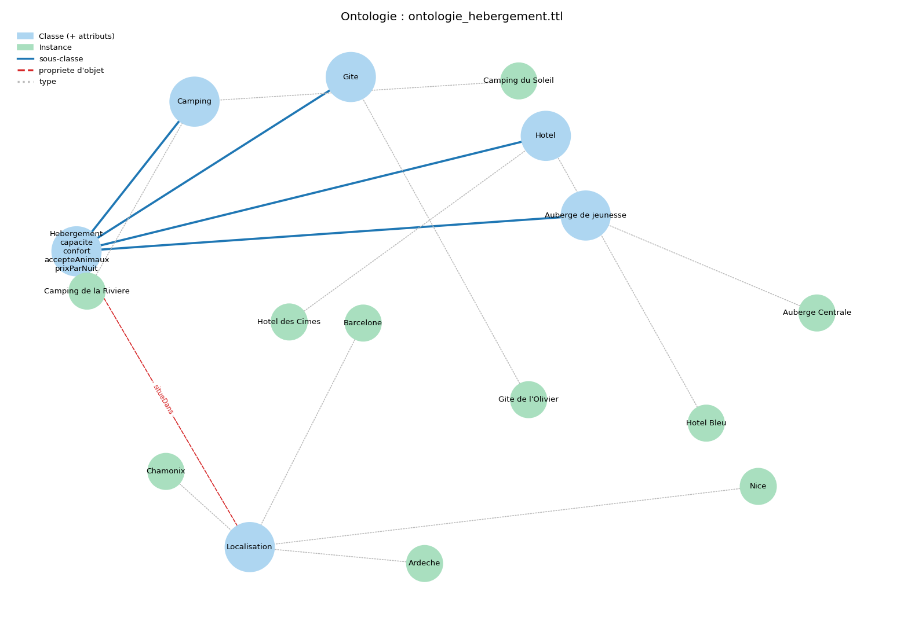
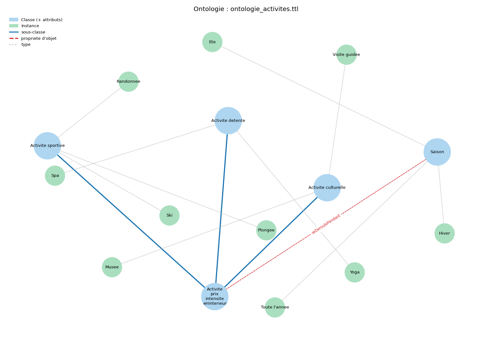
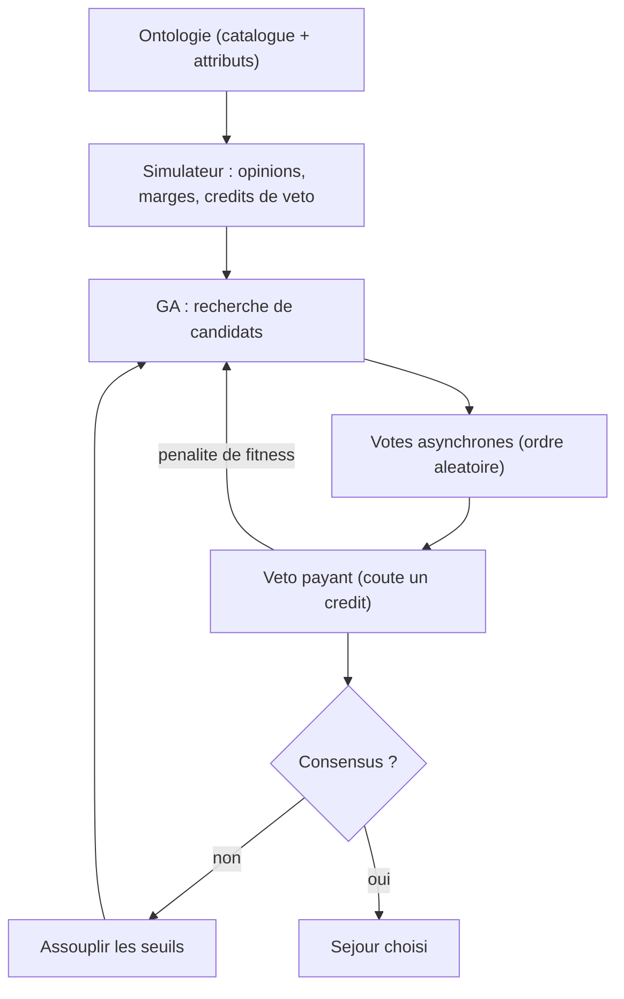

# Projet — Vote de consensus (ontologie + algorithme génétique)

## Objectif

N personnes doivent se mettre d'accord sur **un seul** séjour de vacances. Ce projet combine quatre briques :

1. une **ontologie** qui décrit proprement l'espace des options (type, localisation, semaine, coût, animation) ;
2. un **simulateur d'opinions** : chaque personne a des préférences, une marge de négociation et des crédits de veto ;
3. un **algorithme génétique** qui recherche les meilleurs candidats ;
4. un **protocole de consensus** : votes asynchrones, veto payant et assouplissement progressif des exigences.

C'est une démonstration concrète de l'intérêt d'une ontologie : elle structure le domaine, et le reste du système raisonne dessus.

> **Débutant ? Commencez ici :** **[COURS_DEBUTANT.md](COURS_DEBUTANT.md)** — un petit cours pas-à-pas (à quoi sert chaque script, comment lancer).
> **Piloter le projet :** **[DEVELOPMENT_MAP.md](DEVELOPMENT_MAP.md)** — phases, livrables, tests unitaires, DoD.
> **Documentation extensive** (concepts, architecture, guide produit) : voir le dossier **[docs/](docs/00_INDEX.md)**.
> Pour construire un vrai produit (Consensus Engine + blockchain) : **[docs/PROMPT_PRODUIT.md](docs/PROMPT_PRODUIT.md)**.

## Comment lancer

```bash
pip install -r requirements.txt
python 09_vote_consensus_ga/run.py
# ou interface interactive :
streamlit run 09_vote_consensus_ga/app_negociation.py
```

Ou ouvre le notebook pédagogique [vote_consensus.ipynb](vote_consensus.ipynb) qui déroule tout pas à pas.

### Tests unitaires

```bash
pip install pytest pytest-cov
cd 09_vote_consensus_ga
python -m pytest tests/ -v
```

Sur GitHub, la CI (`.github/workflows/tests.yml`) relance ces tests automatiquement à chaque push/PR sur `main` ou `master` (Python 3.11 et 3.12).

## Fichiers

| Fichier | Rôle |
|---|---|
| `ontologie_vacances.ttl` | L'ontologie : classes (Destination, TypeSejour, Localisation) + catalogue de 12 destinations. |
| `ontologie_vacances2.ttl` | **2ᵉ ontologie, plus réaliste** : zone géographique hiérarchisée (continent → zone), milieu (ville/nature/mixte), sports possibles (hiérarchie nautique/montagne/urbain/nature). |
| `ontologie_hebergement.ttl` | Ontologie « voisine » : hiérarchie d'hébergements (Hotel, Camping, Gite, Auberge → Hebergement). |
| `ontologie_activites.ttl` | Ontologie « voisine » : hiérarchie d'activités (sportive / culturelle / détente) + lien vers une Saison. |
| `visualiseur_ontologie.py` | **Visualiseur générique** : dessine n'importe quelle ontologie `.ttl` (classes, sous-classes, propriétés, instances). |
| `simulateur.py` | Lecture SPARQL de l'ontologie, modèle `Personne`, génération des votants, fonction de satisfaction, **profils NPC** (`PROFILS_NPC`, `creer_npc`). |
| `consensus_ga.py` | L'algorithme génétique, le protocole de vote (votes asynchrones + veto payant) et les **compteurs d'entropie**. Entièrement **paramétrable** (bien-être, critère, mode de vote, mode de veto). |
| `strategies.py` | Les **stratégies interchangeables** : fonctions de bien-être, critères de consensus, et le **moteur exhaustif** (vérité-terrain). |
| `visualisation.py` | Génère la **courbe d'entropie** et l'**arbre de négociation** (matplotlib + networkx). |
| `run.py` | Lance une simulation complète et affiche le résultat. |
| `scenario_branches.py` | Scénario à 3 camps inconciliables qui **explore plusieurs branches** ; sauvegarde `entropie.png` et `arbre_negociation.png`. |
| `vote_consensus.ipynb` | Le notebook pédagogique (catalogue, opinions, GA seul, protocole, démo du veto, entropie + arbre). |
| `comparaison_strategies.ipynb` | Compare les stratégies entre elles (bien-être, GA vs exhaustif, critères, vote, veto) avec tableaux et graphiques. |
| `negociation_manuelle.py` | Moteur de **négociation manuelle** : humains et/ou NPC, mécanismes de forçage (critère dégressif, élimination), auto-run. |
| `app_negociation.py` | **Interface Streamlit** : panneau de vote à gauche, arbre + entropie à droite. |
| `docs/` | **Documentation conceptuelle** : concepts, architecture, guide pratique, glossaire, prompt produit. |
| `COURS_DEBUTANT.md` | **Cours pas-à-pas** pour débutant (scripts, fonctions, lancement). |
| `DEVELOPMENT_MAP.md` | **Carte de développement** : phases, livrables, tests unitaires, DoD. |
| `tests/` | **Tests unitaires** (`pytest`, 49 tests) : simulateur, strategies, consensus_ga, negociation_manuelle. |

## Documentation

| Document | Contenu |
|---|---|
| [docs/00_INDEX.md](docs/00_INDEX.md) | Sommaire et parcours de lecture |
| [docs/01_PROBLEME_ET_VISION.md](docs/01_PROBLEME_ET_VISION.md) | Problème, cas d'usage, feuille de route |
| [docs/02_CONCEPTS_CLEFS.md](docs/02_CONCEPTS_CLEFS.md) | Candidat, satisfaction, bien-être, veto, entropie… |
| [docs/03_ARCHITECTURE.md](docs/03_ARCHITECTURE.md) | Couches, modules, flux de données |
| [docs/PROMPT_PRODUIT.md](docs/PROMPT_PRODUIT.md) | **Prompt pour construire le Consensus Engine + blockchain** |

## Interface interactive (négociation manuelle)

Pour **simuler vous-même** une négociation à plusieurs (sans opinions générées automatiquement) :

```bash
streamlit run 09_vote_consensus_ga/app_negociation.py
```

L'interface est organisée en **4 onglets** (+ barre de statut toujours visible) :

| Onglet | Contenu |
|---|---|
| **Vote** | Proposition courante, votes humains (flèches ◀ ▶), validation du round |
| **Entropie** | Courbe de désaccord + diversité d'exploration, tableau numérique |
| **Chemins explorés** | Arbre de négociation + frise chronologique des options testées |
| **Historique** | Tableau de tous les rounds (export CSV) |

Dans la barre latérale : ontologie, humains/NPC, règles du vote, mécanismes de forçage, bouton « Nouvelle négociation ».

### NPC (votants automatiques)

On peut remplacer tout ou partie des votants par des **NPC** : des personnages aux **préférences définies au lancement** (un profil) qui **votent automatiquement** selon leur satisfaction.

- Si une partie des votants sont humains : les NPC votent tout seuls à chaque round, l'humain complète avec les flèches.
- Si **tous** les votants sont des NPC : un bouton **« Jouer automatiquement »** déroule la négociation jusqu'au bout, sans intervention.

Les profils sont définis dans `simulateur.py` (`PROFILS_NPC`) :

| Profil | Préfère |
|---|---|
| `Fetard plage` | Plage / Espagne / Plongée, animation élevée |
| `Montagnard calme` | Montagne / Suisse / Randonnée, peu d'animation |
| `Citadin culturel` | Ville / Italie / Musée |
| `Econome flexible` | Campagne / France, budget serré, marge large |
| `Routard conciliant` | Plage / Portugal, très conciliant (cède vite) |
| `Aventurier sportif` | Montagne / France / Randonnée |

En Python :

```python
from simulateur import charger_catalogue, creer_npc
from negociation_manuelle import demarrer, jouer_automatiquement, attrs_leader

catalogue = charger_catalogue()
npcs = {n: creer_npc(n, p) for n, p in [
    ("Nina", "Fetard plage"),
    ("Otto", "Montagnard calme"),
    ("Rita", "Citadin culturel"),
]}
etat = demarrer(catalogue, list(npcs), npcs=npcs, critere_degressif=True)
jouer_automatiquement(etat)
print(attrs_leader(etat))  # le séjour choisi automatiquement
```

## Mécanismes pour forcer la décision et la négociation

Une négociation peut s'enliser (chacun campe sur sa position). Le projet propose plusieurs **mécanismes incitatifs**, activables indépendamment :

| Mécanisme | Idée | Où |
|---|---|---|
| **Relâchement progressif** | À chaque round sans accord, les seuils d'acceptation baissent : on devient plus conciliant avec le temps. | `pas_relachement` (toujours actif) |
| **Date butoir (BATNA)** | Sans accord avant `max_rounds`, on **impose** le meilleur compromis non vetoté. La menace du « pas d'accord » pousse à céder. | `max_rounds` |
| **Critère dégressif** | L'exigence se relâche : unanimité → supermajorité (66 %) → majorité simple. Garantit une décision rapide. | `critere_degressif=True` |
| **Élimination progressive** | Le menu **rétrécit** à chaque round (on retire les pires options et les vetotées). L'espace de choix se réduit jusqu'à converger. | `elimination=True` |
| **Veto payant** | Bloquer coûte un crédit limité : on ne peut pas tout refuser éternellement. | `veto_actif=True` |

Effet mesuré (4 NPC, même graine) : sans critère dégressif, consensus en **8 rounds** ; avec, en **5 rounds**.

D'autres pistes possibles (non implémentées, faciles à ajouter) :

- **Jetons de rejet** : chaque votant a un nombre limité de « non ». Une fois épuisés, il doit approuver.
- **Coût d'enlisement monétaire** : le prix monte (ou les bonnes semaines se réservent) à chaque round perdu.
- **Vote final obligatoire** : à la date butoir, on bascule en pluralité (l'option la plus approuvée gagne, toujours).

## Visualiseur d'ontologie

[visualiseur_ontologie.py](visualiseur_ontologie.py) lit **n'importe quel** fichier `.ttl` et en dessine le schéma (avec [rdflib](https://rdflib.readthedocs.io) + [networkx](https://networkx.org)). C'est un outil générique : il marche aussi sur les ontologies des tutoriels (`films.ttl`, `famille.ttl`...).

Légende du graphe :

- **classes** (bleu) avec leurs attributs littéraux listés sous le nom (ex. `prixParNuit`) ;
- **sous-classe** (`rdfs:subClassOf`) : flèche bleue pleine ;
- **propriété d'objet** (domaine → portée entre deux classes) : flèche rouge pointillée, étiquetée par le nom ;
- **instances** (vert) reliées à leur classe par un lien `type` (pointillé gris).

```bash
# Affiche l'ontologie dans une fenêtre
python 09_vote_consensus_ga/visualiseur_ontologie.py 09_vote_consensus_ga/ontologie_activites.ttl

# Ou sauvegarde un PNG, et/ou ne montre que le schéma (sans les instances)
python 09_vote_consensus_ga/visualiseur_ontologie.py ontologie_vacances.ttl --sans-instances --sortie schema.png
```

### Deux ontologies « voisines » (même thème)

Pour s'exercer, deux ontologies supplémentaires sur le thème des vacances montrent une vraie **hiérarchie de classes** (`rdfs:subClassOf`), bien visible sur le graphe :

**Hébergements** (`ontologie_hebergement.ttl`) — Hotel, Camping, Gite, Auberge sont des sous-classes de `Hebergement`, chacune située dans une `Localisation` :



**Activités** (`ontologie_activites.ttl`) — Activité sportive / culturelle / détente, reliées à une `Saison` par la propriété `seDeroulePendant` :



## Plusieurs ontologies : le moteur s'adapte

Le moteur (GA + protocole de vote) **ne connaît pas l'ontologie**. Il dialogue seulement avec trois « contrats » :

1. un **catalogue** = `dict[id_destination -> {nom, cout, semaines:[...], activites:[...], + attributs optionnels}]` ;
2. un dictionnaire global **`ACTIVITES`** (l'activité/sport : `nom`, `saison`, `prix`...) ;
3. une **`Personne`** dont les `poids` indiquent quels critères comptent.

`satisfaction()` et `attributs_candidat()` sont **génériques** : un critère n'est noté que s'il est présent à la fois dans les attributs du candidat **et** dans les poids de la personne. Pour brancher une nouvelle ontologie, il suffit donc d'écrire **un loader** qui produit le catalogue au bon format — sans toucher au GA ni au protocole.

Le projet fournit **deux ontologies** pour le prouver :

| Ontologie | Loader | Critères de satisfaction |
|---|---|---|
| `ontologie_vacances.ttl` (simple) | `charger_catalogue()` | type, localisation, animation, activité, semaine, budget |
| `ontologie_vacances2.ttl` (réaliste) | `charger_catalogue_v2()` | **zone**, **milieu**, sport, semaine, budget |

Dans l'ontologie 2, la **zone** est hiérarchisée (`rdfs:subClassOf` : `Méditerranée` → `Europe`) et les **sports** forment une hiérarchie (nautique / montagne / urbain / nature), avec une **saison** qui filtre les semaines (le ski n'est proposé qu'en hiver). Le candidat reste un triplet `(destination, sport, semaine)`, donc le moteur tourne **sans aucune modification**.

```python
from consensus_ga import rechercher_consensus
from simulateur import charger_catalogue_v2, creer_npc, PROFILS_NPC_V2

catalogue = charger_catalogue_v2()                 # 2ᵉ ontologie
npcs = [creer_npc(n, p, profils=PROFILS_NPC_V2)
        for n, p in zip(["Nina", "Otto", "Rita"], list(PROFILS_NPC_V2)[:3])]
resultat = rechercher_consensus(catalogue, npcs)   # même moteur !
```

Dans l'interface Streamlit, un menu **« Ontologie »** (barre latérale) permet de basculer de l'une à l'autre ; les profils NPC proposés s'adaptent automatiquement.

## Le modèle

### L'espace de recherche

Un **candidat** = un triplet `(destination, activite, semaine)`. Chaque destination apporte ses attributs depuis l'ontologie (type, localisation, coût, animation, semaines disponibles, activités possibles).

### La satisfaction

`satisfaction(personne, candidat)` renvoie un score dans `[0, 1]` : moyenne pondérée de l'adéquation sur 5 critères (type, localisation, semaine, budget, animation). Chaque personne a ses propres **poids**.

### La marge de négociation

Chaque personne approuve un candidat si sa satisfaction dépasse un **seuil d'acceptation**. Une grande marge = seuil plus bas (personne conciliante). Le seuil **baisse à chaque round** sans accord : c'est la pression à la négociation.

## Le protocole de consensus



À chaque round :

1. **Le GA cherche** le meilleur candidat. Sa fitness = `0.5 * moyenne + 0.5 * minimum` des satisfactions. Le terme `min` impose l'équité (on ne sacrifie personne).
2. **Vote asynchrone** : les personnes se prononcent une à une, dans un ordre aléatoire. Chacune approuve si sa satisfaction dépasse son seuil.
3. **Veto payant** : une personne très insatisfaite peut dépenser un crédit pour vetoter le candidat (forte pénalité de fitness, donc le GA l'évite ensuite). Comme les crédits sont limités, **on ne peut pas tout bloquer**.
4. **Assouplissement** : sans consensus, les seuils baissent un peu pour le round suivant.
5. **Consensus** dès qu'un candidat est approuvé par tous et sans veto actif. Sinon, à la fin, on retient le meilleur candidat non vetoté (compromis).

## Pourquoi le veto est-il "payant" ?

Un veto gratuit et illimité permettrait à une seule personne de bloquer éternellement le groupe. En le rendant payant (crédits limités), on **protège une minorité légitime sans lui donner un pouvoir de blocage absolu** : elle peut écarter ses pires options, puis le groupe avance. La démonstration de la section 6 du notebook montre exactement ce comportement avec une votante irréconciliable.

## Entropie et visualisation de la négociation

Pour suivre la dynamique, deux **compteurs d'entropie** sont calculés à chaque round (dans `consensus_ga.py`) :

- **entropie des votes** : entropie de Shannon du partage approuve/rejette. `0` = unanimité, `1` = groupe coupé en deux. C'est une mesure du **désaccord**.
- **entropie d'exploration** : diversité des destinations dans la population du GA (normalisée dans `[0, 1]`). Élevée = le GA explore large ; proche de `0` = il s'est concentré.

`visualisation.py` produit deux figures :

- **`entropie.png`** : les deux entropies round par round (la courbe « refroidit » vers le consensus) ;
- **`arbre_negociation.png`** : l'**arbre de négociation**. Chaque option testée est un nœud ; en **rouge** les options vetotées (branches mortes), en **vert** le consensus final. On voit ainsi toutes les **branches explorées** avant l'accord.

Le script [scenario_branches.py](scenario_branches.py) met en scène **trois camps inconciliables** (plage / montagne / ville) pour forcer l'exploration de plusieurs branches, puis sauvegarde les deux PNG :

```bash
python 09_vote_consensus_ga/scenario_branches.py
```

## Stratégies interchangeables

`rechercher_consensus` accepte plusieurs « briques » que l'on peut recombiner (toutes définies dans [strategies.py](strategies.py)). Le notebook [comparaison_strategies.ipynb](comparaison_strategies.ipynb) les met côte à côte.

**Fonction de bien-être** (`bien_etre=`) — comment agréger les satisfactions :

| Nom | Idée |
|---|---|
| `moyenne` | utilitariste : maximise le bonheur total. |
| `min` | égalitariste (maximin / Rawls) : protège le plus malheureux. |
| `mixte` | compromis `0.5*moyenne + 0.5*min` (défaut). |
| `nash` | moyenne géométrique : équilibre efficacité/équité. |
| `leximin` | priorité lexicographique au plus malheureux. |

**Critère de consensus** (`critere_consensus=`) — quand déclare-t-on l'accord :

| Fabrique | Condition |
|---|---|
| `critere_unanimite()` | tout le monde approuve (défaut). |
| `critere_supermajorite(0.75)` | ≥ 75 % approuvent. |
| `critere_majorite()` | majorité simple (> 50 %). |
| `critere_plancher(0.4)` | personne sous un plancher de satisfaction. |
| `critere_entropie(0.2)` | le désaccord (entropie des votes) passe sous un seuil. |
| `critere_score_moyen(0.6)` | (vote par score) score moyen ≥ 6/10. |

**Mode de vote** (`mode_vote=`) : `"binaire"` (oui/non) ou `"score"` (chacun note de 0 à 10).

**Mode de veto** (`mode_veto=`) :

- `"simple"` : chaque veto coûte 1 crédit (défaut) ;
- `"quadratique"` : le n-ième veto d'une personne coûte n points (blocage répété de plus en plus cher) ;
- `"coalition"` : un veto ne passe que si au moins `k_coalition` personnes bloquent ensemble.

**Moteur exhaustif** : `meilleur_exhaustif(catalogue, personnes, bien_etre)` évalue **tous** les candidats (~88) et renvoie l'optimum exact — pratique pour vérifier que le GA ne se trompe pas.

Exemple :

```python
from consensus_ga import rechercher_consensus
from strategies import bien_etre_nash, critere_supermajorite

resultat = rechercher_consensus(
    catalogue, personnes,
    bien_etre=bien_etre_nash,
    critere_consensus=critere_supermajorite(0.8),
    mode_vote="score",
    mode_veto="coalition", k_coalition=3,
)
```

## Paramètres à régler

- `NB_PERSONNES`, `CREDITS_VETO`, `GRAINE` dans [run.py](run.py) ;
- `SEUIL_VETO`, `PAS_RELACHEMENT`, `PENALITE_VETO` et la taille de population / nombre de générations dans [consensus_ga.py](consensus_ga.py) ;
- le seuil d'acceptation de base dans [simulateur.py](simulateur.py).
