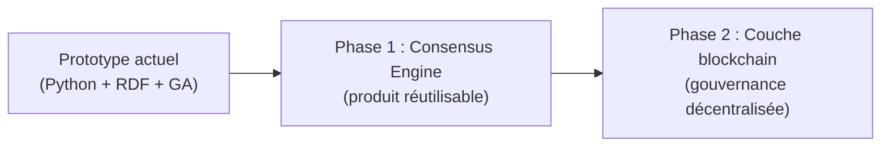

# 01 — Problème et vision

## Le problème

Un groupe de **N personnes** doit choisir **une seule option** parmi un espace combinatorial :

- choisir une destination de vacances **et** une semaine ;
- choisir un budget de projet **et** une répartition ;
- choisir une politique interne **et** un calendrier de déploiement.

Les méthodes naïves échouent souvent :

| Approche naïve | Limite |
|---|---|
| Vote majoritaire sur une liste fixe | ignore les combinaisons (destination × semaine) |
| Chacun propose, on compte les voix | pas de recherche dans l'espace des compromis |
| Le « chef » tranche | pas de légitimité collective |
| Doodle / sondage binaire | pas de modèle de préférences ni de veto structuré |
| Optimisation pure (maximiser la moyenne) | peut sacrifier une minorité |

Ce projet modélise une **recherche de consensus** : le système **explore** l'espace des options, **propose** des candidats, **collecte** des votes, et **converge** vers un accord — ou vers le meilleur compromis possible.

---

## La vision en une phrase

> **Structurer le domaine avec une ontologie, explorer l'espace des options avec un algorithme d'optimisation, et valider les propositions avec un protocole de vote configurable.**

---

## Cas d'usage concrets (au-delà des vacances)

| Domaine | Option à choisir | Attributs structurés |
|---|---|---|
| Vacances (ce prototype) | `(destination, semaine)` | type, localisation, coût, animation |
| Budget d'équipe | `(poste, montant)` | catégorie, impact, échéance |
| Localisation de bureau | `(ville, quartier)` | coût, transports, surface |
| Roadmap produit | `(feature, sprint)` | effort, valeur, dépendances |
| Gouvernance DAO | `(proposition, paramètres)` | impact financier, risque, délai |

Dans tous ces cas, la structure est la même :

1. **Ontologie** : quelles classes, quelles propriétés, quelles instances ?
2. **Espace de recherche** : quelles combinaisons sont possibles ?
3. **Préférences** : comment chaque acteur évalue une option ?
4. **Protocole** : comment le groupe valide ou rejette une proposition ?
5. **Optimisation** : comment le système propose la « prochaine option à tester » ?

---

## Ce que ce prototype démontre

Ce dépôt n'est **pas** un produit fini. C'est un **laboratoire conceptuel** qui montre :

- qu'une **ontologie RDF** peut servir de couche de connaissance partagée (pas juste de stockage) ;
- qu'un **algorithme génétique** peut explorer un espace combinatorial sans tout énumérer ;
- qu'un **protocole de vote** (avec veto payant et assouplissement) modélise une vraie négociation ;
- que l'**entropie** mesure la dynamique du désaccord et de l'exploration ;
- que les **stratégies sont interchangeables** (bien-être, critère, mode de vote, mode de veto).

---

## Deux modes d'utilisation

### Mode simulé (automatique)

Le simulateur génère des personnes avec des préférences, marges et crédits de veto. Le protocole tourne de bout en bout sans intervention humaine.

→ Scripts : `run.py`, `scenario_branches.py`, notebooks.

### Mode manuel (interactif)

L'utilisateur incarne chaque personne et vote lui-même round par round. Le système propose des candidats en fonction des votes déjà exprimés.

→ Interface : `app_negociation.py` (Streamlit).

---

## Feuille de route produit (aperçu)

Ce prototype prépare deux évolutions :

- **Phase 1 — Moteur de consensus** : API, ontologies par domaine, protocoles configurables, UI multi-utilisateur.
- **Phase 2 — Blockchain** : votes signés, vetos tokenisés, preuve d'intégrité du parcours de négociation, exécution automatique de la décision.

Le prompt détaillé pour construire ces phases est dans [PROMPT_PRODUIT.md](PROMPT_PRODUIT.md).

---

## Prochaine lecture

→ [02 — Concepts clés](02_CONCEPTS_CLEFS.md) : définitions précises de tous les objets du système.
