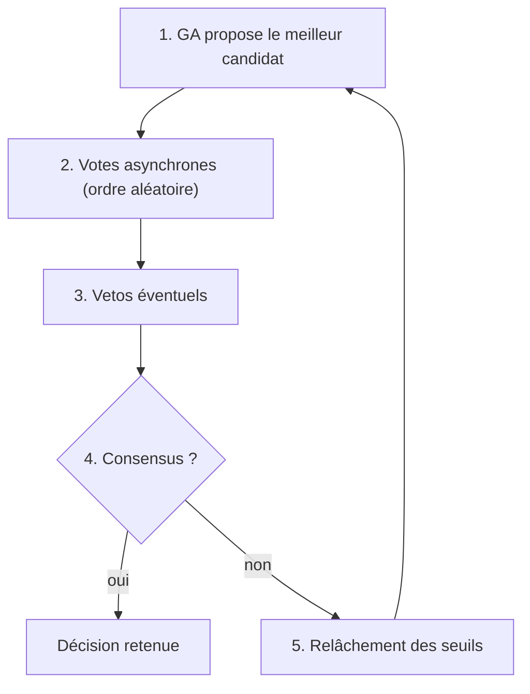
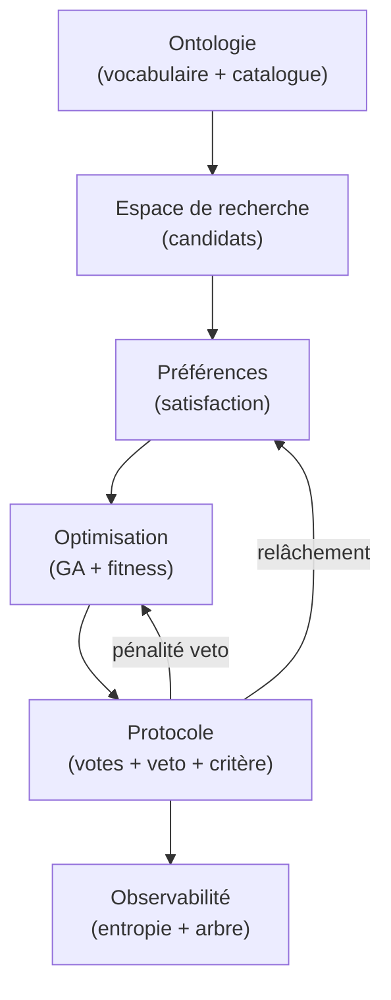

# 02 — Concepts clés

Ce chapitre définit le vocabulaire du projet. Chaque concept est indépendant du code Python : c'est le modèle mental à retenir.

---

## 1. Ontologie et catalogue

Une **ontologie** décrit le **sens** du domaine :

- **Classes** : `Destination`, `TypeSejour`, `Localisation`…
- **Propriétés** : `aPourType`, `coutParPersonne`, `semaineDisponible`…
- **Instances** : Nice, Chamonix, Barcelone…

Dans ce projet, l'ontologie joue **deux rôles** :

1. **Schéma** : le vocabulaire partagé (tout le monde parle la même langue).
2. **Catalogue** : les données concrètes (la liste des destinations et leurs attributs).

→ Voir [04 — Ontologie](04_ONTOLOGIE.md).

---

## 2. Espace de recherche et candidat

L'**espace de recherche** est l'ensemble de toutes les options possibles.

Un **candidat** est un point dans cet espace. Ici :

```
candidat = (identifiant_destination, numéro_semaine)
```

Exemple : `("nice", 30)` = Nice, semaine 30.

Le nombre de candidats = nombre de destinations × semaines disponibles par destination (~88 dans le catalogue actuel).

| Concept | Analogie |
|---|---|
| Espace de recherche | Le menu complet d'un restaurant |
| Candidat | Un plat précis (entrée + plat + dessert) |
| Attributs du candidat | Ingrédients, prix, calories (lues depuis l'ontologie) |

---

## 3. Personne et préférences

Une **personne** (votant) est caractérisée par :

| Attribut | Signification |
|---|---|
| `type_prefere` | Type de séjour idéal (Plage, Montagne…) |
| `localisation_preferee` | Pays/région préféré |
| `semaines_dispo` | Semaines où la personne est disponible |
| `budget_max` | Budget maximum acceptable |
| `animation_preferee` | Niveau d'animation souhaité (0–10) |
| `poids` | Importance relative de chaque critère (somme = 1) |
| `marge` | Capacité à céder (0 = rigide, 1 = très conciliant) |
| `credits_veto` | Nombre de vetos payants restants |

En **mode manuel** (`negociation_manuelle.py`), il n'y a pas de préférences simulées : l'utilisateur vote directement.

---

## 4. Satisfaction

La **satisfaction** mesure l'adéquation d'un candidat pour une personne, dans `[0, 1]`.

Pour chaque critère, un score partiel est calculé :

| Critère | Score = 1.0 si… | Score bas si… |
|---|---|---|
| Type | correspond au type préféré | type différent (0.2) |
| Localisation | correspond | différente (0.4) |
| Semaine | dans les dispos | hors dispos (0.1) |
| Budget | coût ≤ budget max | dépassement progressif |
| Animation | proche de l'idéal | écart sur l'échelle 0–10 |

La satisfaction finale est la **moyenne pondérée** par les `poids` de la personne.

```
satisfaction(personne, candidat) = Σ poids[c] × score[c]
```

**Important** : la satisfaction est **intrinsèque** (objective par rapport aux préférences). La **marge** n'entre pas dans ce calcul — elle sert au seuil d'acceptation.

---

## 5. Seuil d'acceptation et marge

Une personne **approuve** un candidat si :

```
satisfaction(personne, candidat) ≥ seuil_acceptation(personne, relâchement)
```

Le seuil dépend de :

- la **marge** de la personne (grande marge → seuil plus bas → plus conciliante) ;
- le **relâchement** global (augmente à chaque round sans consensus).

C'est le mécanisme de **pression à négocier** : sans accord, les exigences baissent progressivement.

---

## 6. Bien-être collectif (welfare function)

Comment agréger les satisfactions individuelles en **un seul score** pour le groupe ?

| Fonction | Philosophie | Formule (intuition) |
|---|---|---|
| **Moyenne** | Utilitariste | Maximise le bonheur total |
| **Minimum** | Égalitariste (Rawls) | Protège le plus malheureux |
| **Mixte** | Compromis | `0.5 × moyenne + 0.5 × min` |
| **Nash** | Équilibre | Moyenne géométrique (pénalise les très insatisfaits) |
| **Leximin** | Priorité au pire | Poids décroissants sur les satisfactions triées |

Le choix de la fonction de bien-être change **quelle option le GA considère comme « meilleure »**.

→ Voir [06 — Optimisation et stratégies](06_OPTIMISATION_ET_STRATEGIES.md).

---

## 7. Fitness (note d'un candidat)

La **fitness** est le score qu'un candidat reçoit de l'algorithme d'optimisation :

```
fitness(candidat) = bien_être(satisfactions) − pénalité × nombre_de_vetos
```

- Le terme `bien_être` pousse vers l'équité/efficacité selon la stratégie choisie.
- La **pénalité de veto** (`PENALITE_VETO = 1.0`) pousse le GA à éviter les candidats vetotés.

---

## 8. Critère de consensus

Le **critère de consensus** répond à la question : *« Quand déclare-t-on l'accord ? »*

| Critère | Condition |
|---|---|
| Unanimité | Tout le monde approuve |
| Supermajorité (75 %) | ≥ 75 % approuvent |
| Majorité simple | > 50 % |
| Plancher | Personne n'est sous un seuil de satisfaction |
| Entropie faible | Le désaccord mesuré passe sous un seuil |
| Score moyen ≥ 6/10 | En mode vote par note |

Le critère est **indépendant** de la fonction de bien-être : on peut combiner les deux librement.

---

## 9. Veto payant

Un **veto** permet à une personne très insatisfaite de **bloquer** un candidat, mais **au prix d'un crédit limité**.

Pourquoi « payant » ?

- Veto **gratuit et illimité** → une personne peut bloquer éternellement le groupe.
- Veto **payant** → protection légitime de la minorité, sans blocage absolu.

Trois modes implémentés :

| Mode | Mécanisme |
|---|---|
| **Simple** | 1 crédit consommé par veto |
| **Quadratique** | Le n-ième veto coûte n points (escalade) |
| **Coalition** | Un veto ne passe que si ≥ k personnes bloquent ensemble |

Un candidat vetoté reçoit une forte pénalité de fitness → le GA le contourne au round suivant.

---

## 10. Entropie

Deux mesures d'**entropie de Shannon** (normalisées dans `[0, 1]`) :

### Entropie des votes (désaccord)

Mesure le partage approuve/rejette dans le groupe.

- `0` = unanimité (tout le monde d'accord ou tout le monde contre).
- `1` = groupe coupé en deux (50/50).

### Entropie d'exploration (diversité GA)

Mesure la diversité des destinations dans la population de l'algorithme génétique.

- Élevée = le GA explore encore beaucoup d'options.
- Proche de `0` = la population s'est concentrée sur peu de destinations.

→ Voir [07 — Mesure et visualisation](07_MESURE_ET_VISUALISATION.md).

---

## 11. Round de négociation

Un **round** est un cycle complet :



L'**historique** de tous les rounds alimente les visualisations (arbre + courbe d'entropie).

→ Voir [05 — Protocole de négociation](05_PROTOCOLE_NEGOCIATION.md).

---

## 12. Compromis final

Si aucun consensus n'est atteint avant `max_rounds`, le système retient le **meilleur candidat non vetoté** selon la fitness choisie. C'est le **compromis forcé** : pas un accord unanime, mais la meilleure option encore disponible.

---

## Schéma récapitulatif



---

## Prochaine lecture

→ [03 — Architecture](03_ARCHITECTURE.md) : comment ces concepts se traduisent en modules Python.
