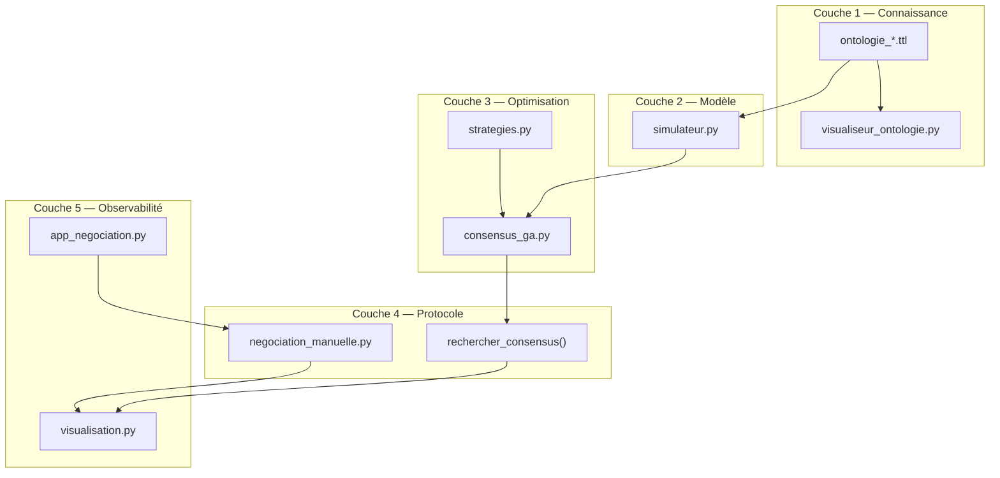
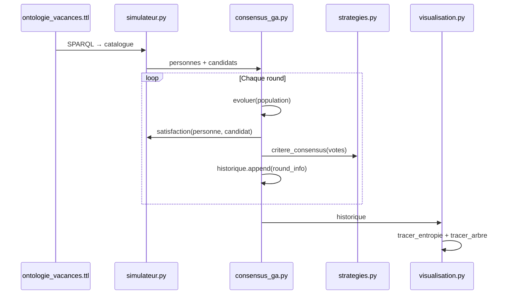
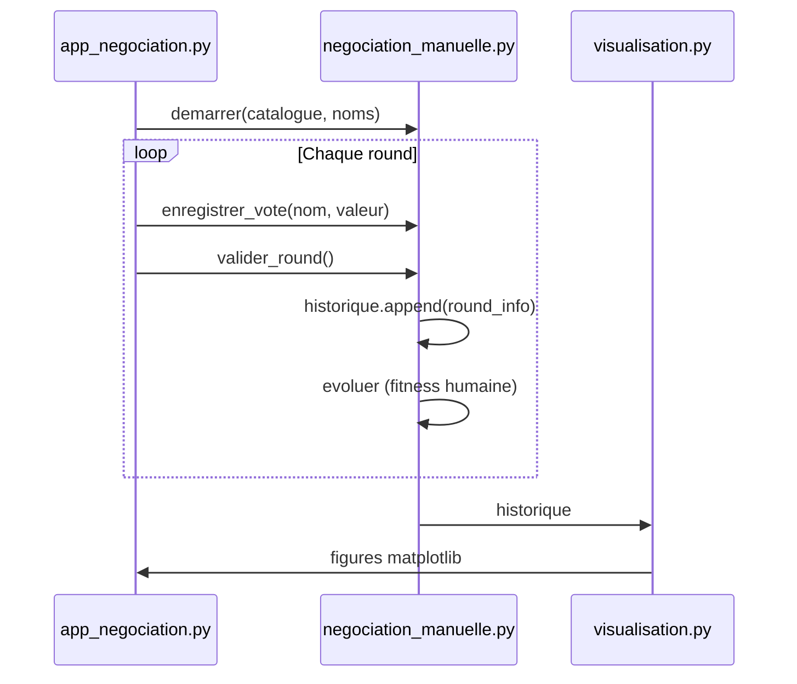

# 03 — Architecture

## Vue d'ensemble

Le système est organisé en **cinq couches** indépendantes, chacune avec une responsabilité claire :



---

## Couche 1 — Connaissance (ontologie)

**Responsabilité** : décrire le domaine et fournir le catalogue de données.

| Fichier | Contenu |
|---|---|
| `ontologie_vacances.ttl` | Schéma + 12 destinations (prototype principal) |
| `ontologie_hebergement.ttl` | Hiérarchie d'hébergements (exercice) |
| `ontologie_activites.ttl` | Hiérarchie d'activités (exercice) |
| `visualiseur_ontologie.py` | Graphe classes/instances/propriétés |

**Interface vers le reste** : le simulateur lit le `.ttl` via SPARQL et produit un `catalogue: dict[str, dict]`.

---

## Couche 2 — Modèle (simulateur)

**Responsabilité** : représenter les votants et calculer la satisfaction.

| Module | Fonctions clés |
|---|---|
| `simulateur.py` | `charger_catalogue()`, `Personne`, `generer_personnes()`, `satisfaction()`, `lister_candidats()` |

**Entrées** : catalogue (dict), personne, candidat.
**Sorties** : score de satisfaction `[0, 1]`, liste de candidats `(dest, semaine)`.

Aucune logique de vote ni d'optimisation dans ce module — principe de **séparation des responsabilités**.

---

## Couche 3 — Optimisation (GA + stratégies)

**Responsabilité** : explorer l'espace et noter les candidats.

| Module | Rôle |
|---|---|
| `consensus_ga.py` | Opérateurs GA (`croisement`, `mutation`, `evoluer`), `fitness()`, `rechercher_consensus()` |
| `strategies.py` | Fonctions de bien-être, fabriques de critères, moteur exhaustif |

**Boucle GA** (par round) :

1. Évaluer la fitness de chaque individu de la population.
2. Élitisme : garder les 2 meilleurs.
3. Sélection par tournoi + croisement + mutation.
4. Répéter sur `generations_par_round` générations.
5. Retourner la population triée par fitness.

---

## Couche 4 — Protocole (négociation)

**Responsabilité** : orchestrer les rounds, collecter les votes, décider.

### Mode automatique (`consensus_ga.py`)

```
rechercher_consensus(catalogue, personnes, ...)
  → Resultat(candidat, attrs, satisfactions, consensus, nb_rounds, historique)
```

Paramètres configurables : `bien_etre`, `critere_consensus`, `mode_vote`, `mode_veto`, `k_coalition`.

### Mode manuel (`negociation_manuelle.py`)

```
demarrer(catalogue, noms, ...) → EtatNegociation
enregistrer_vote(etat, nom, valeur)
valider_round(etat) → bool (consensus atteint ?)
```

Pas de `Personne` simulée : les votes humains alimentent directement la fitness.

---

## Couche 5 — Observabilité (visualisation + UI)

**Responsabilité** : rendre la négociation lisible.

| Module | Produit |
|---|---|
| `visualisation.py` | Courbe d'entropie, arbre de négociation |
| `app_negociation.py` | Interface Streamlit (vote + graphiques) |
| `scenario_branches.py` | Scénario 3 camps + export PNG |

Les visualisations consomment un **`historique: list[dict]`** produit par les deux modes (automatique et manuel). Format unifié :

```python
{
    "round": int,
    "leader": (dest_id, semaine),
    "nom": str,
    "semaine": int,
    "fitness": float,
    "nb_approbations": int,
    "vetos_du_round": list[str],
    "consensus": bool,
    "entropie_votes": float,
    "entropie_exploration": float,
}
```

---

## Flux de données (mode automatique)



---

## Flux de données (mode manuel)



---

## Points d'extension

| Besoin | Où intervenir |
|---|---|
| Nouveau domaine (budget, RH…) | Nouvelle ontologie `.ttl` + adapter `charger_catalogue()` |
| Nouvelle fonction de bien-être | `strategies.py` → `BIENS_ETRE` |
| Nouveau critère de consensus | `strategies.py` → fabrique `critere_*()` |
| Nouveau mode de veto | `consensus_ga.py` → `_appliquer_vetos()` |
| Nouvelle visualisation | `visualisation.py` |
| API REST / multi-utilisateur | Nouveau module (voir [PROMPT_PRODUIT.md](PROMPT_PRODUIT.md)) |

---

## Prochaine lecture

→ [04 — Ontologie](04_ONTOLOGIE.md) : le rôle de la couche de connaissance en détail.
