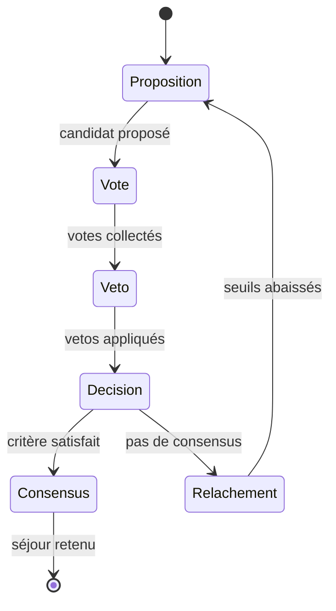

# 05 — Protocole de négociation

## Principe

La négociation est une **boucle de rounds**. À chaque round, le système propose un candidat, collecte les votes, applique les vetos, et décide si le consensus est atteint.



---

## Étape 1 — Proposition (GA)

L'algorithme génétique produit une **population** de candidats et retourne le **leader** (meilleure fitness).

La fitness intègre :

- le bien-être collectif (selon la stratégie choisie) ;
- une pénalité par veto actif sur ce candidat.

Les candidats vetotés sont donc **naturellement évités** aux rounds suivants.

---

## Étape 2 — Vote asynchrone

Les personnes se prononcent **une à une**, dans un **ordre aléatoire** (simule l'asynchronisme d'un vrai vote en ligne).

### Mode binaire

Chaque personne approuve ou rejette selon :

```
satisfaction ≥ seuil_acceptation(personne, relâchement)
```

Le vote humain peut aussi être explicite (mode manuel) : boutons Approuver / Rejeter.

### Mode score

Chaque personne note de **0 à 10**. La satisfaction est `score / 10`. L'approbation automatique se fait si `score ≥ 6`.

Le critère de consensus adapté est `critere_score_moyen(0.6)`.

---

## Étape 3 — Veto

Une personne peut **vetoter** si :

- sa satisfaction est **très basse** (`< SEUIL_VETO = 0.35`) ;
- elle **n'approuve pas** le candidat ;
- elle a encore des **crédits** (mode simple/coalition) ou **points** (mode quadratique).

Le veto consomme une ressource limitée → la personne ne peut pas bloquer indéfiniment.

| Mode | Coût du n-ième veto |
|---|---|
| Simple | 1 crédit |
| Quadratique | n points |
| Coalition | 1 crédit, mais seulement si ≥ k personnes vetotent ensemble |

---

## Étape 4 — Décision (critère de consensus)

Le critère choisi évalue les votes du round. Exemples :

```python
# Unanimité (défaut)
critere_unanimite()  # all(approbations)

# Supermajorité
critere_supermajorite(0.75)  # ≥ 75 %

# Plancher d'équité
critere_plancher(0.4)  # min(satisfactions) ≥ 0.4
```

**Condition supplémentaire** : le leader ne doit **pas** être vetoté.

Si consensus → le candidat est retenu, la négociation s'arrête.

---

## Étape 5 — Relâchement

Sans consensus :

```
relâchement += PAS_RELACHEMENT  # +0.05 par round
```

Les seuils d'acceptation baissent → les personnes deviennent plus conciliantes → le groupe converge.

C'est le mécanisme de **pression temporelle** : refuser indéfiniment a un coût (accepter des options de plus en plus « acceptables »).

---

## Compromis final

Si `max_rounds` est atteint sans consensus :

```python
candidats_libres = [c for c in candidats if c not in vetos] or candidats
meilleur = max(candidats_libres, key=fitness)
```

On retient le **meilleur candidat non vetoté**. `consensus=False` dans le résultat.

---

## Mode manuel (`negociation_manuelle.py`)

Le protocole est **identique conceptuellement**, mais :

- pas de `Personne` simulée ;
- l'utilisateur vote pour chaque rôle (Alice, Bob…) ;
- la fitness utilise les votes humains (candidat non noté = 0.5) ;
- navigation entre personnes via l'interface Streamlit (`◀` / `▶`).

### Différences clés

| Aspect | Mode automatique | Mode manuel |
|---|---|---|
| Préférences | Simulées (`generer_personnes`) | Votes explicites |
| Proposeur | GA + satisfaction simulée | GA-lite + votes humains |
| Interface | Scripts / notebooks | Streamlit |
| Cas d'usage | Démonstration, benchmark | Simulation humaine, pédagogie |

---

## Historique unifié

Chaque round produit un dict compatible avec `visualisation.py` :

```python
{
    "round": 3,
    "leader": ("barcelone", 26),
    "nom": "Barcelone",
    "semaine": 26,
    "fitness": 0.612,
    "relachement": 0.10,
    "nb_approbations": 2,
    "vetos_du_round": ["Alice"],
    "consensus": False,
    "entropie_votes": 0.918,
    "entropie_exploration": 0.743,
}
```

Ce format est le **contrat** entre le protocole et l'observabilité.

---

## Paramètres du protocole

| Paramètre | Fichier | Défaut | Effet |
|---|---|---|---|
| `SEUIL_VETO` | `consensus_ga.py` | 0.35 | Seuil de satisfaction pour vetoter |
| `PAS_RELACHEMENT` | `consensus_ga.py` | 0.05 | Baisse des seuils par round |
| `PENALITE_VETO` | `consensus_ga.py` | 1.0 | Pénalité fitness par veto |
| `max_rounds` | `rechercher_consensus()` | 15 | Limite de rounds |
| `generations_par_round` | `rechercher_consensus()` | 4 | Générations GA par round |
| Seuil d'acceptation base | `simulateur.py` | 0.82 | Rigidité initiale |

---

## Prochaine lecture

→ [06 — Optimisation et stratégies](06_OPTIMISATION_ET_STRATEGIES.md).
