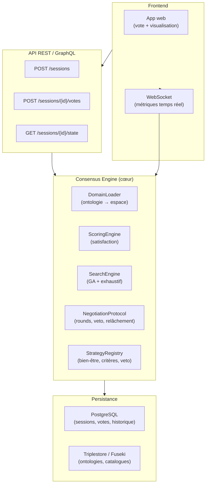
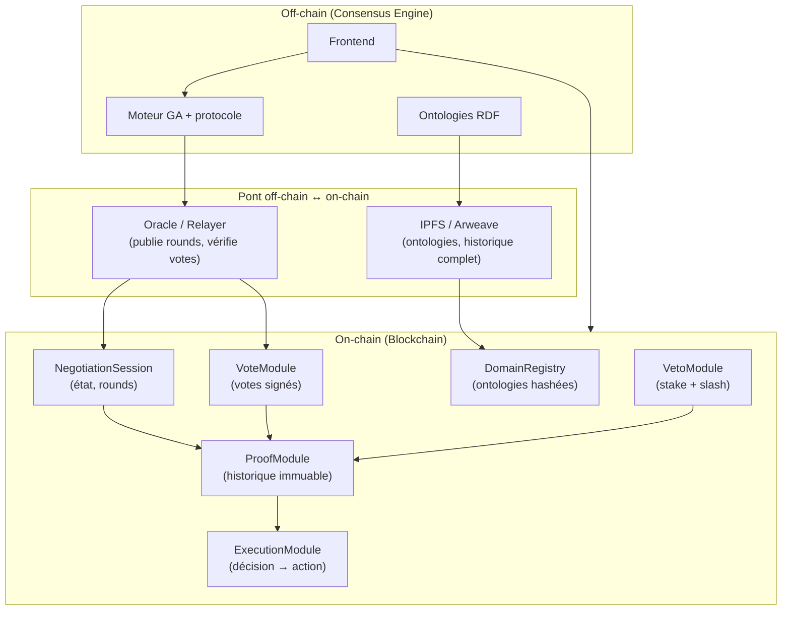

# Prompt produit — Consensus Engine + Blockchain

> **Usage** : copier-coller ce prompt dans Cursor, ChatGPT, Claude ou le brief d'une équipe pour lancer la construction d'un vrai produit basé sur le prototype `09_vote_consensus_ga/`.

---

## Contexte

J'ai un prototype Python fonctionnel qui démontre un **moteur de recherche de consensus** :

- une **ontologie RDF/Turtle** structure l'espace des options (ex. destinations de vacances × semaines) ;
- un **algorithme génétique** explore cet espace et propose des candidats ;
- un **protocole de négociation** collecte des votes (binaires ou par score), gère des vetos payants et assouplit progressivement les exigences ;
- des **stratégies interchangeables** (fonctions de bien-être, critères de consensus, modes de veto) ;
- des **métriques d'observabilité** (entropie du désaccord, arbre de négociation).

Le code source de référence est dans le dépôt `09_vote_consensus_ga/` avec une documentation conceptuelle complète dans `docs/`.

Je veux transformer ce prototype en **deux produits successifs** :

1. **Phase 1 — Consensus Engine** : moteur réutilisable, multi-domaine, multi-utilisateur.
2. **Phase 2 — Couche blockchain** : gouvernance décentralisée, votes signés, preuve d'intégrité.

---

## Phase 1 — Consensus Engine (produit réutilisable)

### Objectif

Construire un **moteur de recherche de consensus** générique, utilisable par n'importe quelle application qui doit aider un groupe à choisir **une option** dans un espace combinatorial structuré.

### Concepts à conserver du prototype

| Concept prototype | Équivalent produit |
|---|---|
| Ontologie `.ttl` | Schéma de domaine configurable (RDF/JSON-LD) |
| `catalogue` (dict) | Base de données d'instances interrogeable |
| `candidat = (entité, paramètre)` | Option générique `(item_id, variante)` |
| `satisfaction(personne, candidat)` | Fonction de scoring configurable par domaine |
| `bien_être(satisfactions)` | Politique d'agrégation (plugin) |
| `critere_consensus()` | Règle d'accord (plugin) |
| `rechercher_consensus()` | Orchestrateur de rounds |
| `historique[]` | Audit trail immuable |
| Entropie + arbre | Dashboard temps réel |

### Architecture cible



### Fonctionnalités MVP (Phase 1)

#### 1. Gestion de sessions

- Créer une session de négociation : `{domain, participants, config}`.
- Configurer : mode de vote, critère de consensus, fonction de bien-être, mode de veto, max_rounds.
- Inviter des participants (lien, email, ou compte).

#### 2. Moteur de domaine (plugin)

- Charger une ontologie/schéma par domaine.
- Construire l'espace de recherche automatiquement.
- API : `register_domain(name, schema, catalog_loader, scoring_function)`.
- Domaines initiaux : `vacances` (prototype existant), `budget`, `localisation_bureau`.

#### 3. Protocole de négociation

- Reprendre la boucle du prototype : proposition → vote → veto → décision → relâchement.
- Votes asynchrones (chaque participant vote quand il veut, dans la limite du round).
- Timeout de round configurable (si quelqu'un ne vote pas → vote par défaut ou relance).
- Historique complet exportable (JSON).

#### 4. Stratégies interchangeables

- Registry de plugins pour : bien-être, critères, modes de veto.
- Interface admin pour choisir la stratégie par session.
- Benchmark intégré : GA vs exhaustif (comme `comparaison_strategies.ipynb`).

#### 5. Observabilité

- Dashboard temps réel : entropie, arbre, statut du round.
- WebSocket pour push des mises à jour.
- Export PNG/PDF de l'arbre et de la courbe d'entropie.

#### 6. API

```
POST   /api/v1/sessions                    # créer une session
GET    /api/v1/sessions/{id}               # état courant
POST   /api/v1/sessions/{id}/votes         # voter {participant_id, value}
POST   /api/v1/sessions/{id}/rounds/next   # forcer le round suivant (admin)
GET    /api/v1/sessions/{id}/history       # historique complet
GET    /api/v1/sessions/{id}/metrics       # entropie, arbre (JSON)
WS     /ws/sessions/{id}                   # flux temps réel
```

### Stack technique recommandée (Phase 1)

| Composant | Technologie suggérée |
|---|---|
| Backend | Python (FastAPI) — réutiliser le cœur du prototype |
| Ontologies | rdflib + Apache Jena Fuseki (ou GraphDB) |
| Base relationnelle | PostgreSQL (sessions, votes, users) |
| Frontend | React ou Streamlit (MVP rapide) → React pour prod |
| Temps réel | WebSocket (FastAPI) ou SSE |
| Auth | JWT + OAuth2 (Google/GitHub) |
| Déploiement | Docker Compose → Kubernetes |

### Critères de succès Phase 1

- [ ] 3 participants peuvent négocier un séjour via le web (sans Python local).
- [ ] Le domaine « vacances » du prototype fonctionne à l'identique.
- [ ] Un second domaine (budget ou autre) est ajouté sans modifier le cœur.
- [ ] L'arbre et l'entropie se mettent à jour en temps réel.
- [ ] L'historique est exportable et rejouable.
- [ ] Tests : GA vs exhaustif sur le domaine vacances (écart < 5 %).

### Livrables Phase 1

1. Repo `consensus-engine/` avec backend, frontend, docker-compose.
2. Documentation API (OpenAPI/Swagger).
3. Guide « Ajouter un domaine » (ontologie + scoring + catalogue).
4. Démo déployée (vacances, 5 participants, 3 rounds).

---

## Phase 2 — Couche blockchain

### Objectif

Ancrer la **gouvernance décentralisée** du consensus : votes signés, vetos tokenisés, preuve d'intégrité du parcours de négociation, exécution automatique de la décision.

### Pourquoi la blockchain ici ?

| Problème sans blockchain | Solution on-chain |
|---|---|
| L'organisateur peut truquer les votes | Votes signés cryptographiquement, vérifiables |
| L'historique peut être modifié | Parcours de négociation immuable (Merkle tree / hash chain) |
| Pas de confiance entre participants | Smart contract = arbitre neutre |
| Le veto est honoré sur parole | Veto tokenisé (stake/consommation on-chain) |
| La décision n'est pas exécutée | Smart contract déclenche l'action (paiement, réservation…) |

### Architecture cible Phase 2



### Concepts blockchain à modéliser

#### 1. Session de négociation (smart contract)

```solidity
struct Session {
    bytes32 domainHash;       // hash de l'ontologie IPFS
    address[] participants;
    SessionConfig config;     // critère, bien-être, mode veto
    uint256 currentRound;
    bytes32 currentProposal;  // hash du candidat proposé
    SessionState state;       // Active, Consensus, Expired
}
```

#### 2. Vote signé

Chaque participant soumet :

```
vote = sign(participant_key, session_id, round, candidate_hash, value)
```

- `value` : bool (binaire) ou uint8 (score 0–10) ou enum (veto).
- Vérification on-chain de la signature.
- Pas de vote double (mapping `participant → round → vote`).

#### 3. Veto tokenisé

- Chaque participant reçoit N **VetoTokens** au début de la session.
- Vetoter brûle 1 token (ou coût quadratique on-chain).
- Tokens non utilisés restitués à la fin.
- Variante avancée : **stake** (dépôt ETH/tokens, slashing si veto abusif).

#### 4. Preuve d'intégrité du parcours

À chaque round, le relayer publie :

```
roundProof = keccak256(session_id, round, candidate, votes[], vetos[], entropy)
```

Chaînée en **hash chain** ou **Merkle tree** → preuve que l'historique n'a pas été altéré.

Stockage complet off-chain (IPFS), racine Merkle on-chain.

#### 5. Exécution de la décision

Quand consensus atteint :

- Le smart contract émet un événement `ConsensusReached(session_id, candidate, proof)`.
- Modules d'exécution selon le domaine :
  - **Vacances** : déclencher un paiement groupé (escrow).
  - **Budget** : allouer les fonds on-chain.
  - **DAO** : exécuter la proposition de gouvernance.

#### 6. Ontologie on-chain

- L'ontologie (schéma + catalogue) est stockée sur **IPFS**.
- Seul le **hash** est enregistré on-chain (`domainHash`).
- Tout participant peut vérifier que le moteur utilise la bonne ontologie.

### Stack technique recommandée (Phase 2)

| Composant | Technologie suggérée |
|---|---|
| Blockchain | Ethereum L2 (Base, Arbitrum) ou Polygon (frais bas) |
| Smart contracts | Solidity + Foundry (tests) |
| Storage décentralisé | IPFS (Pinata / web3.storage) |
| Indexation | The Graph (subgraph pour requêter l'historique) |
| Wallet | MetaMask / WalletConnect + Safe (multisig) |
| Pont | Relayer Python (consensus-engine → contrat) |
| Identité | ENS ou DID (optionnel) |

### Fonctionnalités MVP (Phase 2)

- [ ] Créer une session on-chain avec ontologie hashée sur IPFS.
- [ ] Voter on-chain (binaire) avec signature vérifiable.
- [ ] Veto tokenisé (3 tokens par participant, brûlés au veto).
- [ ] Publier la preuve de chaque round (hash chain).
- [ ] Événement `ConsensusReached` + lecture de l'historique via The Graph.
- [ ] Frontend : connecter wallet, voter, voir l'arbre synchronisé.

### Critères de succès Phase 2

- [ ] 3 wallets peuvent négocier un séjour on-chain (testnet).
- [ ] L'historique on-chain correspond à l'historique off-chain (même hash chain).
- [ ] Un veto consomme bien un token et est visible on-chain.
- [ ] La preuve du parcours est vérifiable par un tiers sans faire confiance au serveur.
- [ ] Coût gas < 0.01 $ par vote (L2).

### Livrables Phase 2

1. Repo `consensus-chain/` : smart contracts, tests Foundry, deploy scripts.
2. Subgraph The Graph pour indexer sessions/votes/vetos.
3. Relayer Python intégré au Consensus Engine.
4. Frontend web3 (vote + visualisation + wallet).
5. Documentation : architecture, modèle de menace, guide de déploiement testnet.

---

## Contraintes transverses

### Sécurité

- Votes signés (EIP-712 en Phase 2).
- Rate limiting sur l'API.
- Validation SHACL des propositions contre l'ontologie.
- Pas de données personnelles on-chain (seulement adresses / hashes).

### Performance

- GA en < 500 ms par round (espace < 10 000 candidats).
- Exhaustif en fallback si espace < 500 candidats.
- WebSocket : latence < 200 ms pour les métriques.

### Extensibilité

- Domaines = plugins (ontologie + scoring + exécution).
- Stratégies = plugins (bien-être, critère, veto).
- Blockchain = couche optionnelle (le moteur fonctionne sans).

### Tests

- Tests unitaires : scoring, stratégies, protocole (reprendre la logique du prototype).
- Tests d'intégration : session complète bout en bout.
- Tests smart contracts : Foundry (vote, veto, consensus, hash chain).
- Tests de charge : 50 participants, 20 rounds.

---

## Roadmap suggérée

| Sprint | Phase | Livrable |
|---|---|---|
| 1–2 | 1 | Backend FastAPI, domaine vacances, API votes |
| 3–4 | 1 | Frontend web, dashboard entropie/arbre, WebSocket |
| 5 | 1 | Second domaine (budget), plugin system, tests |
| 6 | 1 | Déploiement Docker, doc API, démo publique |
| 7–8 | 2 | Smart contracts (session, vote, veto), tests Foundry |
| 9–10 | 2 | Relayer, IPFS, hash chain, subgraph |
| 11–12 | 2 | Frontend web3, testnet demo, doc sécurité |

---

## Fichiers de référence (prototype)

| Fichier prototype | Rôle | À migrer vers |
|---|---|---|
| `simulateur.py` | Catalogue + satisfaction | `ScoringEngine` + `DomainLoader` |
| `consensus_ga.py` | GA + protocole | `SearchEngine` + `NegotiationProtocol` |
| `strategies.py` | Plugins de stratégie | `StrategyRegistry` |
| `visualisation.py` | Métriques | `MetricsService` + dashboard |
| `negociation_manuelle.py` | Mode humain | API votes + frontend |
| `ontologie_vacances.ttl` | Domaine vacances | IPFS + `DomainRegistry` |
| `docs/` | Documentation conceptuelle | Doc produit |

---

## Prompt court (version condensée pour l'IA)

```
Tu es un architecte logiciel senior. Construis un Consensus Engine en deux phases
à partir du prototype Python dans 09_vote_consensus_ga/.

PHASE 1 — Moteur réutilisable :
- FastAPI, PostgreSQL, rdflib, GA + protocole de négociation (rounds, veto
  payant, relâchement, stratégies interchangeables).
- API REST + WebSocket pour sessions multi-utilisateurs.
- Domaines plugin (ontologie RDF + scoring + catalogue).
- Dashboard temps réel (entropie + arbre de négociation).
- Premier domaine : vacances (prototype existant).

PHASE 2 — Blockchain :
- Smart contracts Solidity (session, vote signé EIP-712, veto tokenisé,
  hash chain du parcours, exécution de la décision).
- Ontologies sur IPFS, hash on-chain.
- Relayer Python, subgraph The Graph, frontend web3.
- L2 (Base/Arbitrum), tests Foundry.

Conserve les concepts : candidat, satisfaction, bien-être, critère de consensus,
veto payant, entropie, historique de rounds. Lis docs/ pour le modèle mental.
Commence par Phase 1 MVP backend + domaine vacances.
```

---

## Voir aussi

- [00 — Index de la documentation](00_INDEX.md)
- [01 — Problème et vision](01_PROBLEME_ET_VISION.md)
- [02 — Concepts clés](02_CONCEPTS_CLEFS.md)
- [03 — Architecture](03_ARCHITECTURE.md)
